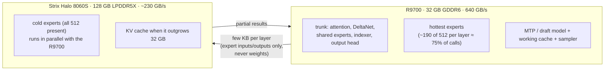
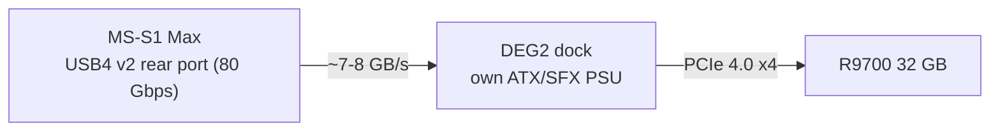
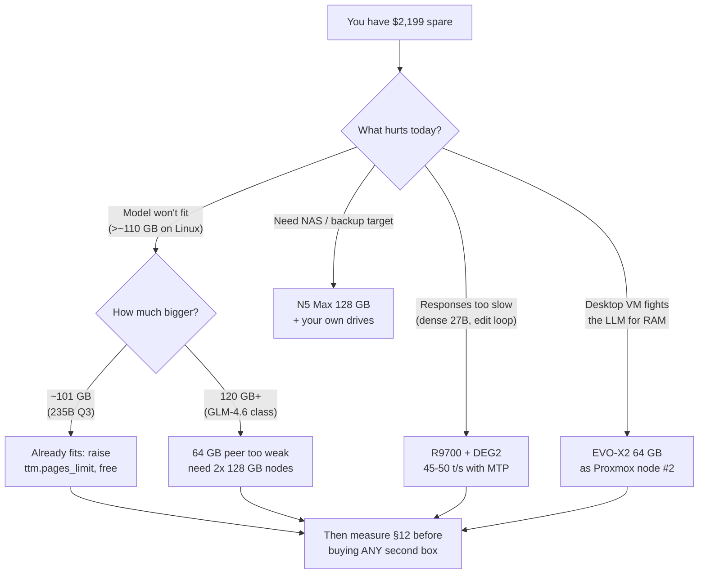
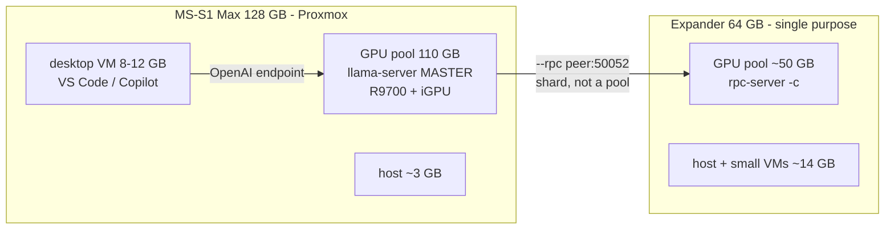
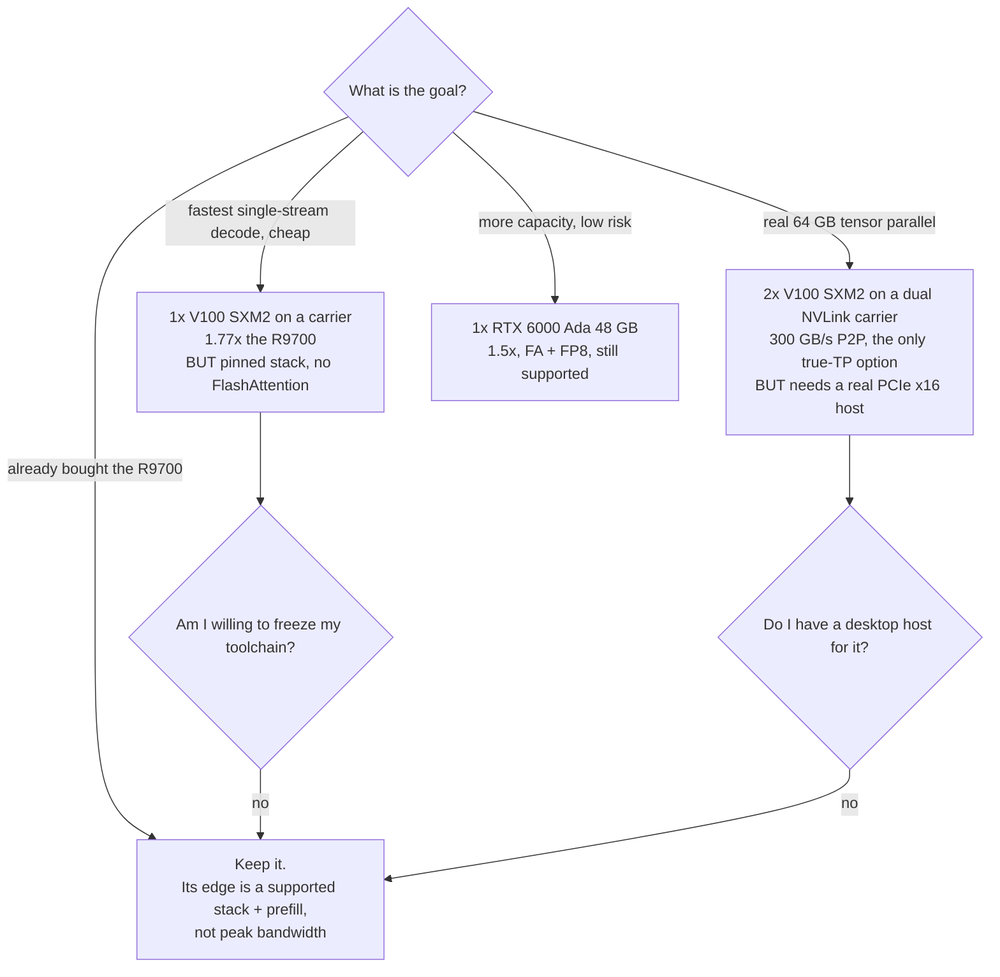
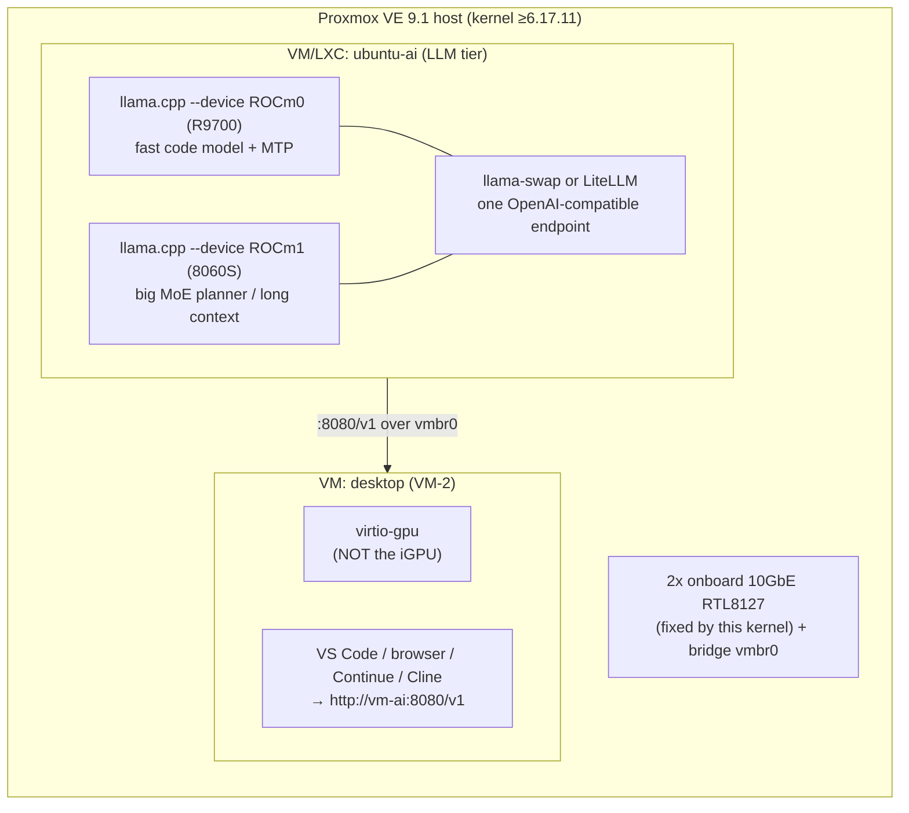

# R9700 32 GB + Strix Halo (Minisforum MS-S1 Max) — Report & Guide

**Written:** 2026-11-07 · **Plan:** [r9700-egpu-plan.md](./r9700-egpu-plan.md)
**My box:** MS-S1 Max · Ryzen AI Max+ 395 · 128 GB unified · Minisforum DEG2 dock · Radeon AI PRO R9700 32 GB
**Actual street cost paid:** MS-S1 Max 128 GB+2 TB **$4,199** · R9700 **$1,899** · DEG2 **$299** (PSU owned).
All vendor prices in this report are same-day snapshots — read **§9c** before quoting any of them.
**Scratch doc — do not commit.** (The R9700 material elsewhere in `docs/` describes the project's
four-card Threadripper machine, not this box.)

Every number is tagged: **[measured]** = someone published a measurement · **[vendor]** = spec sheet ·
**[folklore]** = forum report, single anecdote.

---

## 1. TL;DR — read this on the way to Micro Center

1. **This exact combo exists and works.** Three independent builds: [vuln.dev / xct](https://vuln.dev/local-ai-rig/)
   (GEEKOM A9 Mega + R9700), [Level1Techs / Wendell](https://forum.level1techs.com/t/franken-strix-halo-2x-r9700s-128gb-strix-halo-unified-memory/254736)
   (Framework Desktop + 2× R9700), [Lucebox](https://www.lucebox.com/blog/deepseek-v4-asymmetric-parallelism)
   (sells this as a $5,999 product). None used an MS-S1 Max, but nothing they found is MS-S1-specific except
   the fan-control and 10 GbE notes in §6.
2. **Your win is one R9700 running a model that fits entirely in 32 GB.** That is where the speed is:
   **45–50 t/s on Qwen3.8-27B Q4_K_XL with MTP** vs ~29–34 t/s on the iGPU alone **[measured, vuln.dev]**.
3. **Your loss is any model that doesn't fit.** Splitting one model across R9700 + iGPU over OCuLink
   **loses** performance at long context — vuln.dev tested every split and each lost 10 %+ because the
   attention path crosses the x4 link every token **[measured]**.
4. **Tonight's USB4 connection is probably fine — if you use the right port.** The MS-S1 rear USB-C ports are
   rated **80 Gbps (USB4 v2)** **[vendor, ServeTheHome spec]**, which tunnels ~7–8 GB/s — OCuLink-class.
   The front ports are 40 Gbps (~4 GB/s). Link speed barely affects decode anyway; it affects **load time**.
5. **Two things will surprise you: noise and the power-limit bug.** The MS-S1 stock fan curve throttles at
   93 °C and the board has no standard Linux fan control **[measured, strixhalo.wiki]**. AMD eGPU boards report
   the **dGPU's power cap being tied to the APU's BIOS power limit** **[folklore, strixhalo.wiki]** — check that
   before blaming the card.
6. **Do not buy a PCIe switch — even for a second card.** That is the Level1Techs PEX89xxx pattern in your
   screenshot, and the MS-S1 has no x16 host link to feed one (the SoC's lanes are already spent: primary M.2
   x4 + a **x1** second M.2 + an electrically-x4 internal slot) **[vendor, ServeTheHome]**. Wendell's own
   numbers show the switch *fabric* caps R9700↔R9700 at ~13.4 GB/s regardless of link width **[measured]** —
   below what two independent x4 links give you per card.
7. **A second R9700 buys concurrency and capacity, not speed** on any model that already fits 32 GB — one card
   is active per token (§Stage 3). If you ever add one, the safest route on *this* box is a second dock on the
   other rear USB4 v2 port, because your two-server design needs two independent pipes, not one wide one.
8. **For your OS plan (§10): run Proxmox 9.1 as the host and give BOTH GPUs to the LLM guest.** The desktop VM
   gets virtio-gpu, not the iGPU. If you hand the iGPU to the desktop you throw away the best memory path you own.
9. **Clustering is a capacity play, and it can never add speed.** Nobody has published a mixed-size 64 + 128
   Strix Halo cluster; every documented one (AMD's 4-node Kimi-K2.5, Sapphire's 2-node demo, Starry Hope's
   measured 10–15 t/s on Qwen3-235B) is homogeneous 128 GB. **And the capacity ceiling is higher than the
   spec-sheet reviews say**: the oft-quoted "~96 GB usable" is a **Windows BIOS UMA cap** — on Linux the GPU pool
   is the **TTM/GTT limit**, defaulting to ~50 % of RAM and raisable to **~110–120 GB** with one kernel parameter
   and a reboot **[vendor, ROCm docs]**. Fix that for free before buying a second box. Decode then stays pinned
   to each node's ~230 GB/s no matter how fast your interconnect is (§9e), so at the same $2,199 as a diskless
   GMKtec EVO-X2 64 GB "compute expander," **keep the R9700**: the expander buys a slow (10–15 t/s) bigger-model
   tier, the card buys 45–50 t/s on the tier you actually use (§9d).
10. **Old used cards are not slower at decode — V100 is 1.41× the R9700 (900 vs 640 GB/s), and two V100 SXM2 on a
    modern NVLink carrier is the only 64 GB option here where tensor parallel actually works.** Still not worth
    buying: Volta is frozen in CUDA 12.8, has no mainstream FlashAttention (which hits long-prompt prefill, your
    exact workload), and used 32 GB cards now list $800–999 — about what you paid new for a supported card (§9h).

---

## 2. The physics — why one fast card beats everything else

Inference here is memory-bandwidth-bound, not compute-bound: `tok/s ≈ bandwidth ÷ bytes-read-per-token`
**[measured, multiple]**. That one formula explains every number in this report.

```
Effective memory bandwidth (GB/s, higher = faster decode)

R9700 GDDR6 (32 GB)          640  ████████████████████████████████████  [vendor]  <- per card
Strix LPDDR5X-8000 (128 GB)  ~230 ████████████                          [measured ~230, spec 256]
host → iGPU unified path      ~80  ████                                  [measured, L1]
OCuLink PCIe 4.0 x4          ~7.9 ██                                    [vendor]
USB4 v2 80 Gbps (rear ports) ~7–8  ██                                   [vendor]  ← your tonight option
Thunderbolt 4 / USB4 v1      ~4.0  █                                     [vendor]
```

Three consequences that decide your configuration:

**a) A model that fits in 32 GB decodes ~2.3× faster on the R9700.** Simple ratio of the top two bars.
vuln.dev measured plain decode of Qwen3.8-27B at **28 t/s** and notes that is "roughly what the card's
640 GB/s predicts" **[measured]** — the model isn't beating physics, it's hitting it.

**b) A model that spills across the link decodes ~3× *slower* than either device alone.** Per-token traffic
across OCuLink is only a few KB for expert outputs — fine. But when *attention over the KV cache* has to cross
the link every token, you are streaming gigabytes through a 7 GB/s pipe. vuln.dev: "layer split (`-ts 40,8`) and
MTP draft on the R9700 … win a few percent at short context but lose 10 %+ at long context, because the
per-token attention path then crosses the OCuLink x4 link every step" **[measured]**.

**c) Prefill (prompt processing) scales with device count; decode does not.** Decode reads weights once per
token — bandwidth-bound, one device per token. Prefill is a big matmul — parallelism actually helps. Wendell's
pp512 on Qwen3.6-35B-A3B: **iGPU 1,182 → 2× R9700 2,606 → 3-device 1,420 t/s** **[measured]**. For agentic
coding, where you re-send a large prompt every turn, this matters more than it looks.

### Those bars are *per card* — two R9700s is 64 GB, not 1280 GB/s of decode

The 640 GB/s figure belongs to one card, so it is worth being exact about what a second one doubles, because
the two answers are opposite:

| Bought by a 2nd R9700 | Doubles? | Why |
| --- | --- | --- |
| **VRAM capacity: 32 → 64 GB** | **yes, cleanly** | nothing to coordinate; `gpt-oss-120b` Q4 (63.4 GiB) goes from "does not fit one card" to 100.4 t/s **[measured, L1]** |
| **Concurrency: 2 agents at full speed** | **yes, ~2.0×** | two servers, two cards, zero coordination |
| **Prefill on a split model** | **yes, ~2.2×** | matmuls parallelize (pp512 1,182 → 2,606) **[measured, L1]** |
| **Decode of one stream** | **no, ~0×** | one device is active per token, so per-token bytes still arrive at one card's 640 GB/s |

So the honest shorthand is: **two cards buy you a bigger model and a second agent, not a faster agent.** The
1,280 GB/s number is real only as an *aggregate* across simultaneous work — it is unreachable by a single token
stream, which is why §Stage 3 lists "speed on a model that already fits 32 GB" as **~0×**.

There is receipts for that too. `gpt-oss-120b` reads ~2.87 GB of active weights per token, so 1,280 GB/s
predicts ~446 t/s; Wendell measured **100.4** **[measured, L1]**. That is ~23 % efficiency. The iGPU's 56.5 t/s
against its own ~80 t/s prediction is ~70 %, and the iGPU alone on Qwen3-235B is ~50 % of its prediction. **A split model gets barely a fifth of the bandwidth it nominally
has**, because every token now waits on the slower of two paths plus host coordination — and RCCL has no
`gfx1151` kernels to fix it with **[measured, L1]**. The two-independent-servers design in §7a is the answer:
it reaches ~100 % of each card's bandwidth by never sharing a token.

That makes capacity the ladder to think in, and this box has four rungs:

```
32 GB   one R9700 ........ fast tier: Qwen3.8-27B Q4 at 45-50 t/s
64 GB   two R9700s ....... gpt-oss-120b Q4: 100.4 t/s
128 GB  iGPU alone ....... same gpt-oss-120b at 56.5 t/s; Qwen3-235B-A22B Q3 (~101 GB) at 10-15 after the TTM raise
160 GB+ two boxes ........ only via llama.cpp RPC, and only at 10-15 t/s
```

Note the middle two rows carefully: **your iGPU already runs every model the 64 GB rung can run**, because 64 GB
⊂ 128 GB. What a second card buys at that size is *speed* — 100.4 vs 56.5 t/s on `gpt-oss-120b` — plus the
prefill and concurrency wins above. It is not access. This is the same conclusion §9d reached from the
purchasing side, and it is why the plan's own budget line says no new GPUs: the second card is a
speed-and-throughput purchase, not a capability one. **[measured, L1]**

### Link speed: what it actually costs you

Model load time ≥ size ÷ bandwidth. A 27B Q4_K_M (~16 GB) **[vendor-derived, localaimaster]**:

| Link | Usable | 16 GB load | Decode impact |
| --- | ---: | ---: | --- |
| OCuLink / USB4 v2 | ~7.9 GB/s | ≥2.1 s | none |
| Thunderbolt 4 / USB4 v1 | ~4 GB/s | ≥4.1 s | none |

Per-token traffic is roughly **1 % of a TB4 tunnel**. The link governs *waiting at startup*, not tokens/s —
**unless** the link carries live traffic (§2b). This is the whole reason OCuLink is a quality-of-life upgrade
and not a performance one **[vendor + measured consensus]**.

---

## 3. What the R9700 gives you, by model class

Community-measured results on this hardware family. Read "32 GB fits?" first — it decides everything.

| Model | Quant | Fits 32 GB? | Result on this combo | Source |
| --- | --- | --- | --- | --- |
| Qwen3.8-27B (dense) | Q4_K_XL + Q8 KV | yes (16 GB) | **45–50 t/s** code w/ MTP; 28 t/s plain | [vuln.dev](https://vuln.dev/local-ai-rig/) **[measured]** |
| Qwen3.6-35B-A3B (MoE) | Q8_0 | ~35 GB, spills | iGPU 48.8 · 2×R9700 72.3 · 3-dev 55.5 | [L1](https://forum.level1techs.com/t/franken-strix-halo-2x-r9700s-128gb-strix-halo-unified-memory/254736) **[measured]** |
| gpt-oss-120b (MoE, 5.1B active) | Q4_K_M | 63.4 of 64 GiB, tight | iGPU 56.5 · **2×R9700 100.4** · 3-dev 67.8 | L1 **[measured]** — "don't push the context window" |
| Qwen3.8-Flash-Next (176.9B, 512 exp) | Q4_K_M ~111 GiB | **no** | iGPU alone: GTT OOM; 3-dev 24–28 t/s; EngramHalo fork 24 t/s | L1 **[measured]** |
| GLM-5.3-Flash (320B-A18B) | IQ3_XXS ~113 GB | only with 32 GB added | 14.0 → 10.1 t/s (empty→16k) — "not fast enough", abandoned | vuln.dev **[measured]** |
| DeepSeek V4 Flash (284B) | ROCmFPX 102 GB | no, split by design | **51.1 t/s** median via asymmetric expert parallelism | [Lucebox](https://www.lucebox.com/blog/deepseek-v4-asymmetric-parallelism) **[measured, vendor-run]** |
| Qwen3.8-Flash-Next (125B-A6B) | custom int4 58 GB | no, split by design | **~102 short / 82 at 100k / 71 at 980k t/s** | [vuln.dev pt 2](https://vuln.dev/flash-engine/) **[measured]** |

**The pattern:** fast = fits in 32 GB. Slow-but-usable = fits in 128 GB on the iGPU alone. The
"split across the link" middle ground is where people got burned — the two exceptions that *worked*
(Lucebox, strixpro) required writing a custom engine with expert-level placement, not llama.cpp flags.

### How to fit bigger models than your VRAM
`Qwen3.8-27B` and `Qwen3.6-35B-A3B` are your fast tier. Wendell's answer to bigger-context coding was
**8-bit KV** (`-ctk q8_0 -ctv q8_0`) to buy context instead of weights: the 3-device config ran **262 k native
context with 4/4 needle retrieval** where the iGPU alone could not **[measured]**. For your single card, the
equivalent move is Q8 KV *on the iGPU tier* and a small fast model on the R9700 (§7).

---

## 4. Asymmetric splitting — the one technique that actually works

Both successful teams abandoned tensor split and layer split for the same reason (§2b) and landed on the same
idea: **split by expert hotness, not by layers.**



*Diagram: placement from [vuln.dev pt 2](https://vuln.dev/flash-engine/) and
[Lucebox](https://www.lucebox.com/blog/deepseek-v4-asymmetric-parallelism).*

Rules extracted from both writeups:

- **Ownership follows the hardware.** R9700 gets everything touched every token; Strix holds the long tail.
- **Only activations cross the link, never weights.** "The OCuLink link only carries a few KB per layer, not
  weights" **[measured]**. This is the difference between +70 t/s and −10 %.
- **Tensor parallel (`-tp`/`-sm row`) between unequal GPUs is wrong** — an even split leaves the fast card idle.
  llama.cpp `-sm row` **fails to load MoE models** at all; `-sm layer` is required **[measured, L1]**.
- **The iGPU adds capacity, not throughput.** 3-device beat iGPU-only (+14–26 %) but lost to dGPU-only
  (−23 to −33 %) because the iGPU's ~215 GB/s became the bottleneck **[measured, L1]**.
- **Device order is mandatory: iGPU first** (`--device ROCm2/ROCm0/ROCm1`). dGPU-first crashes prefill with a
  gfxhub page fault — on HIP the iGPU cannot read memory allocated on a dGPU even though the runtime reports
  peer access. Driver-level limitation, not a llama.cpp bug **[measured, L1]**.
- Forum tip worth trying before any custom engine: `kononnable`'s `-ts 0,1,1 -cmoe` — keep the compute-heavy
  part on the dGPU and offload **only expert weights** to the iGPU.

**Honest conclusion for you:** with **one** R9700 you will not be writing an engine. Your realistic playset is
(a) fit-in-32-GB models on the card, (b) big models on the iGPU alone, (c) **two servers, one per device** (§7).
Lucebox sells (d) as a product precisely because it takes a team to build.

---

## 5. Staged bring-up runbook

### Stage 0 — tonight, over the cable you already have



1. **DEG2 needs its own PSU** — ATX or SFX, ≥750 W for a 300 W card headroom-wise. It will not be fed by the
   mini PC **[vendor, Minisforum DEG2 page]**. vuln.dev used a Corsair SF850 with the DEG1 **[measured]**.
2. **Rear USB-C (80 Gbps) not front (40 Gbps).** Verify after boot:
   ```bash
   sudo lspci -vv -s $(lspci | grep -i vga | tail -1 | cut -d' ' -f1) | grep -E "LnkCap|LnkSta"
   ```
   Expect `LnkCap: 32GT/s x16` → `LnkSta: 16GT/s x4`. That "downgraded" reading is **normal and expected** —
   it means PCIe 4.0 x4, which is your ceiling on every path this box offers **[measured, vuln.dev]**.
3. **Kernel ≥ 6.17.11 / 6.18+, not optional on this board** — see §6 for why (Realtek 10 G NICs vanish on older
   kernels, and AMD eGPU wants 6.16+) **[measured, strixhalo.wiki]**.
4. **ROCm covering both architectures** — `gfx1201` (R9700) and `gfx1151` (Strix iGPU):
   ```bash
   rocminfo | grep "Marketing Name"   # want 395 w/ 8060S + AI PRO R9700
   rocm-smi -i
   ```
5. **Build llama.cpp for both arches** in one build (the single biggest time sink in the L1 writeup):
   ```bash
   export ROCM_PATH=/opt/rocm
   cmake -B build -DCMAKE_BUILD_TYPE=Release -DGGML_HIP=ON -DGGML_HIP_NO_VMM=ON \
     -DGGML_HIP_ROCWMMA_FATTN=OFF -DAMDGPU_TARGETS="gfx1201;gfx1151"
   cmake --build build --target llama-server llama-bench -j"$(nproc)"
   ```
   Two traps, both **[measured, L1]**: `ROCM_PATH` must be exported or HIP autodetect fails, and a stale
   `GPU_TARGETS` in `CMakeCache.txt` **silently** overrides `AMDGPU_TARGETS` — purge with `cmake -U GPU_TARGETS`.
   rocWMMA is **off**: as of ROCm 7.0.2+ it is slower at depth for Strix and unmaintained **[strixhalo.wiki]**.
   Easiest shortcut: prebuilt wheels from Lemonade `llamacpp-rocm` (covers gfx1151 + gfx120X) or the
   `kyuz0` Strix Halo containers **[community]**.
6. **First benchmark, on the card:**
   ```bash
   HIP_VISIBLE_DEVICES=0 ROCBLAS_USE_HIPBLASLT=1 ./build/bin/llama-bench \
     -m qwen3.8-27b-UD-Q4_K_XL.gguf --device ROCm0 -ngl 999 -p 512 -n 128 -r 3
   ```
   Sanity target: **tg ≈ 25–30 plain**, **pp512 well into four figures**. If tg comes back ~15, layers are
   landing on the CPU — recheck `-ngl 999` and that the 32 GB shows in `rocm-smi`.
7. **Verify the power-limit bug before accepting a slow card** (§6, gotcha #2).

### Stage 1 — the OCuLink that lives in the DEG2 already

Your DEG2 has **dual OCuLink (PCIe 4.0 x4, "up to 64 Gbps") and USB4 v2 in the same box** **[vendor]**, so
Stage 1 is a cable change, not a purchase. Use the OCuLink port; leave USB4 as a fallback.

- **Power off both, then cable.** OCuLink is not reliably hot-pluggable.
- If you ever add a *second* device via M.2→OCuLink instead: the wiki reports the adapters are flaky and
  **M2OC-3 is the best found so far** **[folklore]**; vuln.dev's first adapter "did not work reliably at Gen4 …
  the card dropped off the bus," fixed by one **with a signal driver/redriver** **[measured]**.
- Expected delta vs USB4 v2: **a couple of seconds of load time and better stability**, not more tokens/s.
- Wendell's kernel flags for multi-GPU stability are worth adopting preemptively (single card too):
  ```
  amdgpu.runpm=0 pcie_port_pm=off pci=realloc
  ```
  `runpm=0` avoids D3→D0 wake failures that caused load-average-39 storms and KDE restart loops **[measured, L1]**.
  And **do not set `amdgpu.vm_size=128`** — with RDNA4's 57-bit VM and 4-level paging it produced a kernel
  use-after-free (`general protection fault` in `amdgpu_vm_cpu_update`) **[measured, L1]**.

### Stage 2 — PCIe switch: skip it

Your screenshot is Framework Desktop's **PCIe 4.0 x4 → PEX89xxx → 2× PCIe 5.0 x8**. On an MS-S1 you have x4
Gen 4 to begin with; a switch cannot create host bandwidth you don't have, and it costs more than the dock
(`Emil_N`, L1: "the fabrics are more expensive than a complete board"). Wendell's own P2P table is the
close argument: **R9700↔R9700 ~13.4 GB/s, bottlenecked by the switch fabric, not the link** — "even a
twice-as-wide connection would still be fabric-bound" **[measured]**. Gen 5 PEX boards are also effectively
unobtainable; Gen 4 (PLX88xxx) is what's actually on eBay **[measured]**.

### Stage 3 — a second R9700: what actually pays (FYI, not a near-term recommendation)

First, separate the three things a second card can buy, because only one of them is what people expect:

| Gain | Size | Evidence | Needs |
| --- | --- | --- | --- |
| **Concurrency** (2 agents at full speed) | **~2.0×** | trivially: 1 card/token means a 2nd card never speeds up one stream | nothing — two servers, no P2P |
| **Capacity** (64 GB VRAM) | fits `gpt-oss-120b` Q4 (63.4 GiB) | **100.4 t/s** on 2×R9700 vs 56.5 iGPU **[measured, L1]** | one PCIe path per card |
| **Split-MoE throughput** | +48 % (35B-A3B Q8: 48.8→72.3) | L1 matrix **[measured]** | P2P or low-latency interconnect |
| **Prefill** (long agent turns) | **2.2×** (pp512 1,182→2,606) | L1 **[measured]** | model split across both |
| **Speed on a model that already fits 32 GB** | **~0×** | physics: one card active per token | — |

The last row is the one to internalize: **two R9700s will not make your current fast model faster.** They will
let you run two agents at that speed, or run a bigger model at all.

**Your host cannot do what Wendell did, and it is worth knowing why.** Strix Halo's lane budget is already
spent on the MS-S1 Max **[vendor, ServeTheHome]**:

```
Strix Halo PCIe lanes on MS-S1 Max
├── primary M.2 ............... PCIe 4.0 x4  (your boot SSD)
├── second M.2 ............... PCIe 4.0 x1   ← one lane; useless for a GPU
├── internal PCIe slot ....... physical x16, electrical PCIe 4.0 x4
│                              + half-height full-length only + no PSU headroom (320 W total, APU 160 W)
├── USB4 v2 rear ports ....... ~7-8 GB/s tunneled (each shares the same controller budget)
└── 2x onboard 10GbE RTL8127
    (STH's reviewer independently asked "there must be switch chips in this" — the SoC is out of lanes)
```

So for a second card, ranked by risk:

1. **Second dock on the other rear USB4 v2 port — recommended if ever.** No BIOS surgery, no P2P needed
   (because §7a's two-server plan wants zero P2P), ~7–8 GB/s each. This is the whole reason the two-server
   design is the right shape for *this* box: it needs two independent pipes, not one wide one.
2. **Free the primary M.2 x4 for an OCuLink adapter** (the vuln.dev path). Trick worth noting: **the DEG2 has
   its own M.2 2280 slot** **[vendor]**, so you can boot from the dock and reclaim the host's x4 for card #2.
   Do **not** relocate boot to the x1 second M.2 — that's a 1-lane drive on your OS disk.
3. **PCIe switch (Wendell's PEX pattern).** Not available to you as he used it — there is no x16 host link to
   feed it, and his own measured **R9700↔R9700 ≈ 13.4 GB/s, fabric-bound regardless of link width** **[measured]**
   means the switch caps you below what two independent links already give you per-card.
4. **Internal slot.** Physically impossible for a 300 W three-slot card, and electrically no better.

**Critical caveat nobody publishes for two *external* links:** with no switch, GPU↔GPU peer access must route
through the host root complex — two link traversals. Wendell already proved the sibling case is broken on this
platform (the iGPU cannot read dGPU-allocated memory on HIP even though the runtime *reports* peer access)
**[measured, L1]**. Expect `-sm tensor`/`-tp` across two externally-attached cards to fail or to be slow.
Also **[measured, L1]**: RCCL ships no `gfx1151` kernels, so collective-based tensor parallelism isn't a
fallback. Two independent servers completely sidestep all of this.

If you ever want real dual-GPU tensor parallelism, the honest answer is **a different host**: `redxherring`
(L1) runs 2×R9700 on a **desktop X870E board with two PCIe slots + DDR5**, and `asluiter` runs a
**Highpoint 1628A switch card** in a real board with 2×x16. A desktop AM5 board simply has more usable lanes
than this SoC, plus PSU headroom. Two R9700s in a $400 desktop beats two R9700s bolted to a Strix Halo for
tensor-parallel work.

---

## 6. Gotchas checklist (the ones that cost other people a week)

1. **Kernel too old → the MS-S1's 10 G NICs disappear.** Realtek RTL8127 unstable on older kernels; kernel
   `220770`. Need **6.17.11 / 6.18+** **[measured, strixhalo.wiki]**.
2. **dGPU power cap follows the APU's BIOS power limit.** Reported across GMKtec EVO-X2 and Framework: a card
   that can draw 300 W gets clamped to whatever you set for the APU **[folklore, strixhalo.wiki]**. Check under
   load: `watch -n1 rocm-smi --showpower`. If it sits near your APU limit, raise the APU/mobo power profile in
   the MS-S1 BIOS.
3. **MS-S1 fans: no standard Linux control.** Stock curve is ~40 % duty at 93 °C → APU hits Tjmax and throttles
   under sustained inference; no hwmon PWM, no tach, no ACPI fan object, and Fedora's `ec_sys` is unavailable
   while Secure Boot lockdown blocks debugfs **[measured]**. Fix: **`ms-s1-max-fans-control`** — signed module
   exposing the EC as `/dev/strixec` with fan curves + systemd persistence, works under Secure Boot + SELinux
   (CPU temp at EC `0x09`, curves at `0x11`/`0x31`). Not an AXB35-02 EC layout — do not reuse other boards'
   values.
4. **`rocm-smi` shows a healthy card that is actually power-starved.** Cross-check clock + power + junction,
   not just presence.
5. **Vulkan vs ROCm is a real choice, not a preference.** Vulkan sometimes wins `tg`; ROCm wins `pp`. Vulkan
   hits "GGGG" garbage-output failures in some situations **[community consensus, strixhalo.wiki]** — but
   vuln.dev's best dense-model number (50–80 t/s) came from **Vulkan + MTP** **[measured]**. Try both backends
   for *your* model; keep the ROCm build for prefill-heavy work.
6. **Known ROCm GPU hangs** remain open on RDNA3.5/RDNA4 (`ROCm/ROCm#5151`); a benign boot-time
   `sdma0 ring timeout` that self-recovers is reported normal **[community]**.
7. **Windows path has a trap:** a Strix display-off GPU throttle with no confirmed server-mode fix — every
   number in one published Windows benchmark set was measured with the display forced **on**
   **[measured, ihanesman]**. Linux avoids this class of problem.
8. **Noise is a first-order design constraint.** vuln.dev: R9700 capped 300→**210 W** (driver minimum) with a
   −500 MHz offset and fan capped ~1500 rpm, iGPU capped 2900→2000 MHz, CPU boost off (3.0 GHz) — and *decode
   barely moved*, because decode is bandwidth-bound. 300 W→250 W cost **~8 %** **[measured]**.
   ```bash
   amdgpu.ppfeaturemask=0xfff7ffff   # kernel cmdline: enables overdrive bits (default mask + overdrive)
   ```

---

## 7. Squeezing it for agentic coding, ranked

| Rank | Change | Why it wins | Evidence |
| --- | --- | --- | --- |
| 1 | **Pick models that fit 32 GB fully** (Qwen3.6-35B-A3B / Qwen3.8-27B tier) | Bandwidth ratio is the whole game: 45–50 t/s vs 29 | [measured] |
| 2 | **Prompt-prefix stability + `--cache-prompt`** | Agent harnesses re-send a huge prefix every turn; a cache miss re-prefills thousands of tokens. In agentic coding this is usually bigger than tg | prefill is the expensive phase [measured, §2c] |
| 3 | **Speculative decoding (MTP / draft model)** | MTP took 28→45–50 t/s on the same weights (acceptance ~0.73 on code); Lucebox's single biggest jump was batching the verifier (+13 t/s) | [measured] |
| 4 | **Two servers, one per device** — R9700 = fast decoder, iGPU = capacity/batch tier; route by **explicit model name** (`llama-swap`), not by heuristic | Separate bandwidth + separate prompt caches + per-tier optimization regime (§7a). Routing *heuristics* cost more than they return | [folklore, strong] + §7a |
| 5 | **Raise the GPU memory pool: small BIOS carve-out + `amd-ttm --set 110`** | Default GTT is ~50 % of RAM (~64 GB); raising it is the difference between "Qwen3-235B fits" and "needs a second box." One reboot, no hardware | [vendor, ROCm docs] §9d |
| 6 | **8-bit KV (`-ctk q8_0 -ctv q8_0`)** | Halves the cache; Wendell's 262k/4-of-4 retrieval run used it. Pairs with #5 — free the bytes the KV would otherwise eat | [measured] |
| 7 | **Concurrency for parallel agent calls** (`--parallel`, batched requests) | One card per *token*, but tokens from different requests batch — prefill headroom is on the R9700 | [measured §2c] |
| 8 | **Quant ladder down only when context demands** | `peteru` (L1): "the larger the context the higher the quant you need to unlock it" — i.e. don't over-quantize a 32 GB card to buy context | [folklore] |
| 9 | **Power/clock caps for noise** | ~8 % cost, large acoustics win | [measured] |
| 10 | **RAM clock / C-states / hugepages / `numactl`** | Helps the iGPU tier (your capacity tier); the wiki has a Power Modes page + C-States page. **Do not chase a bigger BIOS UMA carve-out** — AMD says keep it at 512 MB and use GTT instead (§9d) | [vendor] + [folklore] |
| 11 | **Skip: `-sm row`, `-tp` across unequal GPUs; skip PCIe switch** | measured failures | [measured] |

### 7a. Deep dive: does a multi-model agentic router actually help here?

Short answer: **yes on the iGPU tier, marginal-to-negative on the R9700 tier, and only if routing is explicit
rather than "smart".** Three findings drive this, and two of them contradict the easy optimism.

**Finding 1 — MTP and concurrency are enemies, and that kills the "batch everything on one card" plan.**
Native MTP speculative decoding is worth ~2.16× single-stream decode (13.1→28.3 t/s on Qwen3.6-27B on a GB10
DGX Spark) **[measured]**, but the same report states it **"regresses under concurrency."** MTP's draft is a
sequential chain through the model; `--parallel N` slots interleave decode steps, which both lowers draft
acceptance and removes the spare bandwidth that made speculation free. Meanwhile plain batched decode gets a
*near-free* win when slots share weights — the per-token bandwidth cost is paid once, for N sequences.

That's the fork in the road, and it maps exactly onto your two devices:

| Tier | Bandwidth | Right mode | Why |
| --- | ---: | --- | --- |
| **R9700** | 640 GB/s, 32 GB | **`--parallel 1` + MTP**, one hot model | Single-stream latency is the goal; MTP is the bigger multiplier. One 16 GB model + MTP beats four slots of anything |
| **iGPU** | ~230 GB/s, 128 GB | **`--parallel 4–8`, NO MTP** | Bandwidth-poor and capacity-rich — the textbook place to batch. Four agents decoding one MoE is ~4× aggregate throughput at near-zero marginal bandwidth |

Splitting your *concurrency strategy* per device is worth more than any router.

**Finding 2 — multiple `llama-server` processes on ONE GPU fail unless you add TTL unloading.**
The documented failure: two processes "fighting over the same GPU memory, each partially loaded, both failing"
under real concurrent load **[community, Lehmann + llama-swap docs]**. The fix is llama-swap's `ttl` —
unload after N idle seconds so VRAM frees for the next model. On the R9700's 32 GB this is mandatory if you
want more than one resident model; note it means paying reload cost on switching — 2.1–4.1 s for a 16 GB model
(§2), and longer from cold page cache. **On the iGPU tier you can skip TTL entirely:** 128 GB holds several
models at once, so llama-swap's TTL is a memory tool you simply don't need there.

**Finding 3 — the per-tier prompt-cache split is the actual quiet win, not the model routing.**
An agent harness re-sends a large, mostly-stable prefix every tool call. That prefix's KV cache is per-server
and per-model, so:
- **R9700, one model, `--parallel 1`:** cache capacity concentrates on the exact prefix being resumed → the
  highest possible cache-hit rate on the fastest device.
- **iGPU, `--parallel 4–8`:** each slot owns independent KV, so cache is *fragmented* across slots — good for
  throughput, worse for per-request TTFT. Use it for fire-and-forget bulk work (repo indexing, summarization,
  embedding-ish sweeps, background review) where TTFT doesn't matter.

**So: what routing should do.** Route by **explicit model name in the request** (one llama-swap front door,
agents pick the model), *not* by a proxy that guesses from prompt content. Reason: a misroute costs a full
re-prefill — seconds — plus a wasted reload if TTL already evicted the model. A wrong guess is far more
expensive than a boring choice, and the harness already knows which model it wants.

**Verdict, ranked:**

| Approach | Worth it? | Cost to build | Payoff |
| --- | --- | --- | --- |
| Two llama-server instances, one per device, one llama-swap front door, explicit model names | **Yes** | ~1 hour | Best aggregate: fast edit loops + high-throughput bulk tier |
| `--parallel 4–8` **without** MTP on the iGPU for concurrent agents | **Yes** | one flag | ~4× aggregate on the capacity tier |
| `--parallel 1` **with** MTP on the R9700 | **Yes** | one flag | ~2× on your latency-critical path |
| Same model resident on both devices, load-balanced | **No** | medium | Zero benefit — it's the same weights twice; you'd rather have two *different* models |
| Content-heuristic routing ("complex → big model") | **No** | high | Misroutes cost seconds; harnesses already know their intent |
| Auto-switching one model in/out of the R9700 by demand | **Only with TTL + stickiness** | medium | Reload stalls feel like hangs mid-agent-loop; keep it sticky |
| Router that also does retries/fallback between tiers | **Marginal** | low | Useful for OOM/timeout resilience only |

**Concrete target shape:**

```
llama-swap :8080  (single OpenAI-compatible base URL for Continue/Cline/Aider + Copilot BYOK)
├─ r9700-fast    llama-server --device ROCm0 --parallel 1 --spec-type draft-mtp -c 32768
│                Qwen3.6-35B-A3B or Qwen3.8-27B Q4_K_XL   → edit loops, agent steps, autocomplete
│                ttl: -1 (never unload; it is the only model here)
└─ halo-bulk     llama-server --device ROCm1 --parallel 6 -fa 1 -ctk q8_0 -ctv q8_0 -c 65536
                 big MoE, iGPU   → repo Q&A, long-context reads, background review, batch jobs
                 ttl: 0 (128 GB has room; keep it hot)
```
*(device order caveat: llama.cpp's own `--device ROCm2/ROCm0/ROCm1` iGPU-first rule in §4 applies to
**multi-device single-model** runs. Separate single-device servers sidestep it entirely — another reason to
prefer two servers over one split model.)*

**One free model alongside Copilot, stated plainly:** start with just the R9700 server and `--parallel 1` + MTP
on Qwen3-Coder-class 30B-A3B or Qwen3.6-35B-A3B. Add the iGPU bulk tier only once you feel a specific need for
it (background indexing, or a second agent harness you don't want to make you wait).

---

## 8. What others run: OS & configuration survey

| Who | OS / kernel | ROCm | Notable config |
| --- | --- | --- | --- |
| vuln.dev (xct), GEEKOM A9 Mega + R9700 **[measured]** | **Ubuntu 26.04** | **7.2.3** | M.2→OCuLink (needed a redriver), DEG1 + SF850; Vulkan + MTP; 210 W cap; Lian Li B4 case |
| Level1Techs (Wendell), Framework + 2× R9700 **[measured]** | **CachyOS**, kernel 7.1.x | **7.2.4** | PEX89xxx switch; `pci=realloc`, `amdgpu.runpm=0`, `pcie_port_pm=off`, `iommu=off`, `amdgpu.gttsize=114688`, `ttm.pages_limit=29360128` |
| strixhalo.wiki iGPU-passthrough guide **[measured]** | **Proxmox 9.1**, kernel 6.17.4-1-pve | guest ROCm | guest = CachyOS; Proxmox 9 "a must" for reset bug |
| strixhalo.wiki general **[community]** | **any Linux 6.16+** + linux-firmware git | latest/TheRock nightly | `ROCBLAS_USE_HIPBLASLT=1`; no rocWMMA |
| ihanesman (Strix laptop) **[measured]** | Windows 11 | — | llama-swap; display-off throttle caveat; no fixed BIOS carve-out |
| matnum **[measured]** | CachyOS, kernel 7.2.10 | — | 10 model/quant cells × Vulkan & ROCm incl. tokens-per-watt — useful reference table |

Consensus: **latest kernel beats distro choice.** Ubuntu LTS with an HWE/newer kernel or a rolling distro are
both proven; what matters is ≥6.17.11 and ROCm 7.2.x with both `gfx1201`+`gfx1151` built in.

---

## 9. RDMA / multi-box: is a network interconnect ever better than a second card?

I originally wrote "don't buy a ConnectX card" here. The wiki's clustering page **corrects that** — there is a
proven path, and the *interconnect* is trivially cheap next to a GPU. Do not read that as "clustering is cheap":
the interconnect is €133, the **second box it connects is $3,679–4,199** (§9c). It still isn't for *you* yet,
for a better reason than I originally gave.

**The proven recipe (strixhalo.wiki, Bosgame M5 × 2) [measured]** — total ~€133:

| Item | Cost |
| --- | ---: |
| 2× Mellanox ConnectX-3 CX354A (PCIe 3.0 x8, used) | 2 × 23 € |
| 1× Mellanox 56 G QSFP+ FDR DAC, 0.5 m | 18 € |
| 2× M.2 → OCuLink adapters + PCIe x16 slot adapters | ~49 € |
| Small ATX PSU (needs only ~20 W) + 24-pin splitter | ~26 € |
| + a 3D-printed case, a fan (the cards draw ~10 W each) | — |

Caveats baked into their own numbers: the **PCIe 3.0 x4** link caps the cards at **~26 Gbit/s** despite the FDR
DAC being 56 G-capable **[measured]**, and each box spends an M.2 slot. Their dmesg shows exactly that:
`31.504 Gb/s available PCIe bandwidth, limited by 8.0 GT/s PCIe x4 link`.

**Why anyone bothers: latency, not bandwidth.** The wiki's framing is that at **~1 µs** latency, *tensor
parallelism can provide a speedup* — that is the entire point. A soft-RDMA variant runs over
**USB4/Thunderbolt** with no extra hardware at all (their linked repo runs DeepSeek V4 Flash that way)
**[community]**, and your MS-S1's rear USB4 v2 ports are better candidates than the TB3 ports that page was
written against. So the zero-cost experiment exists: **soft-RDMA over your existing USB4, two boxes.**

**But the physics is unflattering, so calibrate expectations:**

```
Interconnect for cross-device per-token traffic (your options)

host → iGPU unified memory      ~80 GB/s   100%  [measured L1]  ← inside one box
OCuLink / USB4 v2               ~7.9 GB/s   10%  [vendor]      ← 2nd card, same box
InfiniBand FDR DAC (PCIe 3.0x4) ~3.3 GB/s    4%  [measured]     ← 2nd BOX, best case
10GbE (onboard RTL8127)         ~1.2 GB/s   1.5% [vendor]
soft-RDMA over USB4             < ~7 GB/s    —   [community]    ← latency ≠ wire speed
```

Cross-*box* tensor parallelism must move activations at ~3.3 GB/s where inside-one-box gets ~7.9 and
same-die unified gets ~80. That is why §2b killed layer-splitting at 7.9 GB/s — the network is worse, not
better. **RDMA wins only if its latency saves you enough to overcome a 2.4× bandwidth deficit versus a second
OCuLink link on one box.** The wiki asserts the ~1 µs case makes TP possible; nobody has published a
tokens/s number proving it beats a second card on the same box, and I would not assume it does.

**Where clustering genuinely beats a second GPU for your use case:** not for one fast agent — for
**throughput across independent jobs**. Two Strix Halos over DAC each run their own model with no link in the
decode path at all (§2b is not in play), which is strictly better than splitting one model across a slow link.
Two boxes also gives you 2 × 128 GB unified instead of +32 GB. Corrected for street prices, the honest framing
is: **a second MS-S1/EVO-X2 + ConnectX DAC is a better-*documented* and higher-capacity path than a second
R9700, but not a cheaper one** — the €133 interconnect is trivial next to the $3,679–4,199 box it connects
(§9c). Buy it for capacity and isolation, never because clustering sounded cheap. Interconnect cost ≠ total cost.

**What I'd still say no to (unchanged, now for the right reason):** a ConnectX card for *single-box* use. You
already have 2×10 GbE onboard for model transfer (~30 GB in ~24 s), an internal card is capped at your x4 Gen 4
slot, and RDMA has no peer to talk to until a second machine exists. Networking only enters the picture the day
you buy a second box.

**Decision table for "more performance later":**

| Goal | Buy | ~Cost | Why |
| --- | --- | ---: | --- |
| Two agents at current fast speed | 2nd R9700 + 2nd DEG2 on rear USB4 | **$2,198** | 2× concurrency, no P2P needed |
| Run a bigger model at all (64 GB) | same as above | **$2,198** | `gpt-oss-120b` at 100 t/s **[measured]** |
| Aggregate capacity for bulk/offline jobs | **2nd Strix Halo box + CX3 DAC** | ~€133 + box | 256 GB unified, no link in decode path |
| 2nd box that is also a NAS | Minisforum **N5 Max 128 GB** (see §9b) | $3,679 | same SoC as yours in a 10-bay quiet case; the 64 GB SKU adds less than you own |
| One model, real tensor parallel | **a desktop AM5 host** w/ 2×x16 | rebuild | Strix lanes can't feed it (§Stage 3) |
| Speed on a model that already fits 32 GB | **nothing — you're done** | $0 | one card per token; buy a smaller quant instead |

### 9a. Second Strix box vs second R9700 — the capacity-vs-bandwidth argument

> ⚠️ **Read §9c before trusting any dollar figure in this section.** The per-GB asymmetry argued below is
> directional and it still holds, but every absolute number here is from vendor pages captured the same day and
> must be re-quoted before you buy. The 128 GB SKU is the one this argument favours; the 64 GB SKU is half as
> favourable per added GB — and added GB is the only thing that counts when you already own 128 GB.

A 128 GB Strix Halo box without data drives is, functionally, **128 GB of soldered LPDDR5X at roughly the price
of 32 GB of GDDR6 in an R9700.** That asymmetry is the whole argument, and it is stronger
than the "cheaper GB" framing suggests, because of *where* the memory sits:

```
What a second box adds vs what a second card adds

2nd R9700        +32 GB @ 640 GB/s, reached over x4 (~7.9 GB/s)   [vendor]
                 └── cannot be read by the iGPU as peer memory (§Stage 3)
2nd Strix box  +128 GB @ ~230 GB/s, reached as the local iGPU (~80 GB/s)  [measured, L1]
                 └── a first-class device in its own box; nothing crosses a link inside a token
```

The second box is not "a worse GPU far away." In its own box its iGPU gets the **~80 GB/s unified path** — the
fastest per-token path on this platform family. What crosses the wire is only whatever you deliberately split.
It also lands at **~160 W max vs 300 W** for a card + dock + PSU, and needs no VFIO, no ROCm multi-device
driver work, and none of the kernel flags from §Stage 1.

**Three concrete gains:**

1. **Concurrency, cleanly.** Two independent 128 GB capacity tiers, zero shared failure domain, zero
   driver-level device-order bugs. Each runs its own model at full local speed (§2b never applies).
2. **Capacity for the models that only *fit* in 128 GB** — Qwen3.8-Flash-Next-class MoE at ~111 GiB, which
   vuln.dev's card could not use and Wendell needed three devices to run **[measured]**. Two boxes = two of
   those, not one awkward one.
3. **Real distributed options that don't need RDMA.** llama.cpp's `ggml-rpc` backend pools memory across
   nodes over a normal LAN and is proven for exactly the "neither box alone can host it" case **[community,
   Duonary]**. And **the split matters more than the link**: llama.cpp discussion #30671 measured that the
   default *memory-proportional* layer split is wrong for heterogeneous nodes — it sat 13–28 % of layers off
   the balance point and **lost up to 2.4× on prompt processing** versus the speed-derived split
   (`s* = t_slow/(t_fast+t_slow)` → 63 % of layers to the fast node for generation, 78 % for prefill)
   **[measured]**. For a machine-learned tip: probe per-device throughput at load, then split by *speed*,
   not by capacity. Their proposed `--ts-speed` isn't merged — you'd set `--tensor-split` by hand.
   Caveat from the same source: **network bandwidth directly dictates prompt-processing speed** in RPC
   setups, so prefill suffers on 10 GbE even when decode is fine.

**The SSD-less part is the real constraint, not the savings.** No local disk means every model load comes over
the wire — at 10 GbE (~1.25 GB/s) a 30 GB model is ~24 s, and over a 26 Gbit DAC ~10 s. Three mitigations, in
order of value:

- **Let the 128 GB act as the cache.** With `-lm mmap` / normal file reads, the page cache holds the model
  library hot in RAM after first touch, so only the *first* load after boot pays the network cost. This is
  the one case where 128 GB without local storage is nearly a non-issue.
- **NFS or iSCSI from box 1** (jumbo frames, pinned to one of the two 10 G ports). Box 1's NVMe becomes the
  shared model store; ~5 s and ~24 s respectively for a 30 GB model from a warm store.
- **If it's also your Proxmox node:** SSD-less breaks the default install story (VM disks, and HA needs shared
  storage). Use ZFS-on-NFS or iSCSI from box 1, or just add a used 1 TB NVMe — it is still the cheapest part
  of the plan and removes an entire class of problems.

**And a calibration on the fancy option:** Lucebox sells an official cluster kit — **ConnectX-5 Ex, 2×100 GbE,
on a PCIe 4.0 x4 link**, +€869/machine **[vendor]**. A PCIe 4.0 x4 link tops out near **63 Gbit/s**, so those
two 100 G ports **cannot run at line rate simultaneously**. Their own product confirms the ceiling this whole
platform hits: you can buy latency, but the lanes are still the lanes. So the €133 ConnectX-3 recipe is not a
budget compromise on anything the expensive kit could do for a single model — it is the same lane-limited
story at a fifth of the price.

**Verdict (at 2026-11 street prices, see §9c):** for your stated use — agentic coding, one interactive stream +
background jobs, no tensor-parallel ambitions — **the R9700 you already bought is the better spend than a second
128 GB box.** At street cost the card+dock is **$2,198** vs **$3,679+** for a second 128 GB Strix box, and it is
the *faster* option for any model that fits 32 GB — cheaper and quicker at once. The second box only wins if
**you need a NAS anyway** (take the 128 GB SKU) or **you need >32 GB of added capacity** for concurrent
independent jobs. My earlier draft of this verdict assumed ~$2,300 for a 128 GB box; that was a training-era
number the current RAM market has left behind.

### 9b. The N5 Max AI NAS: right product, wrong SKU for beating the R9700

Real product, real price: **Minisforum N5 Max AI NAS — Ryzen AI Max+ 395, 5× HDD + 5× NVMe, 2× 10GbE
(RTL8127), 2× USB4 v2 80 Gbps, dual 10 G + HDMI, 250 W external PSU, LPDDR5X-8000 default (8533 OC option),
$2,399 sale / $2,999 list** for the **64 GB** SKU; **$3,679** for **128 GB** **[vendor, store.minisforum.com]**.
Same 256-bit bus as the MS-S1 Max, so the same ~230 GB/s class. Your "MS-S1 in a NAS case" read is exactly right.

**Those prices are for a diskless box.** The bays are empty at shipping — "5× HDD" is *capacity*, not inventory,
and the "~200 TB" figure floating around is the sum of largest-supported drives, not what you get. If you
actually want populated storage, price it in: 5 × 18 TB enterprise HDD is roughly $900–1,200 on top **[folklore,
street pricing]**, plus whatever the 4× x1 M.2 slots cost. So the honest comparison against the R9700 is
**$2,399 bare + drives**, not $2,399 for a filled NAS — which matters more than usual here, because hard-drive
prices are moving for the same DRAM-adjacent supply reasons as §9c.

**Three facts from its own spec sheet that decide this:**

1. **The 64 GB SKU buys you less memory than you already own.** You have 128 GB. The 64 GB box adds 64 GB —
   which is only 2× the 32 GB the R9700 adds, at 230 GB/s instead of 640 GB/s. Every model a 64 GB box can hold,
   your existing box already holds and runs at the same speed.
   **It adds a second lane, not a faster lane, and half as much of it as you have.**
2. **No OCuLink, no PCIe slot on the N5 *Max*.** Its I/O is 1× USB4 40 Gbps, 2× USB4 v2 80 Gbps, 2× 10GbE,
   HDMI — the storage controller ate the lanes (1× M.2 2280 x4 + 4× M.2 at x1 + 5× SATA). Beware the spec-sheet
   trap: the **OCuLink port and PCIe x16 (electrically x4) slot belong to the N5 *Pro***, which is an
   **HX PRO 370 with DDR5 SO-DIMM and a 780M iGPU — a much worse inference box** (~90 GB/s dual-channel DDR5,
   not 256-bit LPDDR5X). If you shop the NAS line for OCuLink, you land in the wrong product.
   Same story as §Stage 3: on a Strix Halo box, an extra x4 means evicting the boot NVMe (here: use the DEG2's
   M.2 slot to boot from, and M.2→OCuLink the freed x4).
3. **It is officially a Linux box** (MinisCloud OS / Windows 11 / Linux), so wiping MinisCloud and installing
   Proxmox is supported territory — but it also means the NAS features (ZFS, snapshots, LZ4, semantic search,
   MinisOpenClaw) are what you're *actually* paying the premium for.

**Head-to-head for agentic coding, using this report's own numbers:**

| | **R9700 ($1,899 + your $299 DEG2 = $2,198)** | **N5 Max 64 GB (street $2,399)** |
| --- | --- | --- |
| Added memory | 32 GB @ **640 GB/s** | 64 GB @ ~230 GB/s |
| Interactive decode, dense 27B class | **45–50 t/s** (MTP) vs 28 plain **[measured]** | no change — still ~28 on box 1 |
| Interactive decode, MoE (gpt-oss-120b Q4) | 100.4 t/s **needs 2 cards**; 1 card ≈ **56–64** tier | **56.5 t/s on box 1 iGPU already** **[measured, L1]** |
| Prefill (the agentic-coding sleeper) | **2.2× on 2 cards** (pp512 2,606 vs 1,182) **[measured]** | no change |
| 2 concurrent agents at full speed | yes | yes |
| Fits a model you can't run today | `gpt-oss-120b` Q4 (63.4 GiB, needs 2 cards) | none on Linux — 64 GB ⊂ your 128 GB, and §9d's TTM fix already reaches ~110 GB |
| Storage / NAS / backup target | no | **5 HDD + 5 NVMe bays, ZFS, ~200 TB raw — but ships diskless, budget drives separately** |
| Extra PSU, dock, cables, noise | needs ≥750 W PSU + dock | self-contained, quiet, 250 W total |
| Risk | ROCm multi-device, kernel flags, power-cap bug | near zero — separate box |

**The honest answer: keep the card.** For agentic coding the card buys the two things that dominate your
wall-clock — decode tokens/s on the dense/latency-critical edit loop and prefill on the big re-sent prompt —
while the 64 GB box buys a *third* copy of capacity you already have and zero speed on a sequential agent
chain. Two slow lanes only help if you genuinely run independent jobs concurrently, and one 128 GB box already
holds two servers (§7a).

**Flip the answer if any of these is true:**
- **You need a NAS anyway.** Then it isn't "NAS *or* GPU," it's NAS + a free second AI engine. At that point
  take the **128 GB** SKU — 64 GB is the one variant that adds nothing you lack.
- **You're a MoE-only person.** Wendell's iGPU-alone numbers (**48.8** on Qwen3.6-35B-A3B Q8, **56.5** on
  gpt-oss-120b Q4) are already comfortable for agent loops. If you never run dense 27B-class, the card's
  marginal speed is smaller than the table implies, and a second box's concurrency looks better.
- **You want silence and a rack, not a GPU rig.** 33–38 dB and one cable beats a 300 W blower + dock + PSU.

### 9c. Pricing rule for RAM-heavy hardware (learned the hard way, twice)

**Do not trust advertised prices or training-era memory for RAM-heavy products. Their price is set by the DRAM
market, not by product generation or MSRP.** Verified against my own receipts, 2026-11-07:

| Item | Street price I paid (new) | Why it matters |
| --- | ---: | --- |
| MS-S1 Max 128 GB + 2 TB | **$4,199** | used units go for **the same or more**; a "deal" on one may not exist |
| Radeon AI PRO R9700 32 GB | **$1,899** | cheapest in the country — "the deal" was timing, not shopping |
| Minisforum DEG2 dock | **$299** | had a PSU already → **total GPU path: $2,198** |

Consequences for every cost comparison in this report:

- **128 GB of soldered LPDDR5X is now worth roughly $4,000 of box**, so "cheap second Strix box" framing is
  wrong for this market. The second box is $3,679+ (N5 Max 128 GB) or ~$4,200 (another MS-S1 Max) — not $2,300.
- **Unified memory is actually the cheaper memory per GB; the card only looks cheap because it is the only way
  to buy a *small increment*.** Measured off the receipts above: card path = **$69/GB** (32 GB for $2,198) vs
  unified at **$33/GB** (MS-S1 $4,199/128) or **$29/GB** (N5 Max 128 GB, $3,679/128). Nobody sells 32 GB of
  unified, so the practical alternative to a card is buying a whole 128 GB box — **you pay $3,679 to add memory
  you may not need, or $2,198 for a fast 32 GB you will definitely use.** That, not raw $/GB, is the real trade.
  Per-GB-per-GB/s, the card is far better value: **$3.43 per GB/s** ($2,198 ÷ 640 GB/s) vs **$14.10** for the N5
  Max 128 GB box ($3,679 ÷ ~261 GB/s theoretical bus) — **4.1× cheaper per unit of bandwidth**, which is the
  resource that actually governs tokens/s. The cheaper memory per GB is also 2.5× the price per GB/s.
- **RAM-saturated parts don't depreciate normally.** Used MS-S1 Max units listing at or above new means there is
  no buyer's surplus to find — budget street price, not MSRP, and do not expect a used bargain in 6 months.
- **Every vendor figure in this document is a same-day snapshot.** Lucebox's "$5,999 system" and "€869 cluster
  kit" **[vendor]**, the N5 Max "$2,399/$3,679" **[vendor]**, ServeTheHome's port spec — re-quote all of them
  on the day you buy. Assume anything about RAM-containing products from before this cycle is stale.
- **Sunk-cost note so nobody over-reads the tables:** the $2,198 is already spent, so §9b/§9a comparisons are
  only useful for the *next* purchase. The forward-looking question is never "card vs box in the abstract," it is
  "**what do I add given I already own 128 GB + one R9700**" — and for that, §12's measurement log decides.

**Cheapest experiment that tests the router idea before spending anything:** the two-tier split in §7a uses only
hardware you own (R9700 tier + iGPU tier). Run it for a month, log which tier gets used and the prompt-cache hit
rate (§12 #5). That log tells you whether you need *speed* (→ already have it), *concurrency* (→ second box), or
*capacity* (→ 128 GB box, not 64 GB). Buying before that log exists is how everyone in §3 ended up publishing
"this split didn't pay off."

---

### 9d. GMKtec EVO-X2 64 GB at $2,199 — the same-price question, head-to-head with the card

**Verified from the GMKtec page (variant `46826048422042`):** EVO-X2 395 **64 GB + 1 TB = $2,199**; 128 GB + 1 TB
= **$3,499**; 128 GB + 2 TB = $3,649. Specs: LPDDR5X-8000 (8-channel, same ~256-bit bus), **dual M.2 2280 both
PCIe 4.0 x4** (up to 16 TB), Wi-Fi 7 (MT7925), **1 × RJ45 — 2.5 GbE only (RTL8125BG)**, 120 W typical / 140 W
peak, external USB-C PD 30 W adapter. **No OCuLink** — that is the **EVO-X3**; the two "OCuLink" strings on that
page are cross-sell links to it **[vendor]**.

**First, a pricing trap worth flagging: the 64 GB SKU is the worst per-GB value in the line.**

| SKU | Price | $/GB |
| --- | ---: | ---: |
| EVO-X2 **64 GB** | $2,199 | **$34.4** |
| EVO-X2 **128 GB** | $3,499 | **$27.3** |
| My MS-S1 Max 128 GB + 2 TB | $4,199 | $32.8 |

The 128 GB variant is **21 % cheaper per GB** than the 64 GB one, and it's $700 below what I paid for an MS-S1
(different I/O, but same silicon). RAM-driven pricing means the *bigger* SKU carries proportionally less
markup — the opposite of normal consumer intuition, and the reason "cheap 64 GB" is a false economy here.
(§9c again: re-quote these the day you buy.)

**Second: has anyone clustered a 64 with a 128? I found no documented instance, and there's a reason.**

Every published Strix Halo cluster is homogeneous 128 GB:

| Cluster | Nodes | Pool | Link | Result |
| --- | --- | --- | --- | --- |
| AMD official (Framework Desktop) | 4 × 128 GB | 512 GB | 5 GbE Ethernet | Kimi-K2.5 (trillion-param) UD_Q2_K_XL ~375 GB **[vendor]** |
| Sapphire Edge demo, Embedded World 2026 | 2 × 128 GB | 256 GB | USB-C between the two boxes | Qwen3-235B class **[vendor demo]** |
| Starry Hope measurement | 2 × Sapphire Edge 395 | 256 GB | Ethernet | **Qwen3-235B-A22B Q3_K_S (~101 GB) at ~10–15 t/s** **[measured]**; the "3–5 t/s dense" figure is a *projection*, never run |
| DGX Spark pair | 2 × 128 GB | 256 GB | ConnectX-7 200 GbE direct | no switch needed |

Consensus rule from that data set **[measured]**: **clustering adds memory capacity, never memory bandwidth —
and it only pays off for MoE models above ~100 GB.** Two Strix Halos over Ethernet were measured at 10–15 t/s
on a 235B MoE **that cannot fit on one box at all**. For a model that *does* fit, splitting makes it slower.

**Correction to my first draft of this section.** I initially wrote that the 2.5 GbE NIC "kills it." The
arithmetic says otherwise, and getting this right matters, because it changes what you'd actually be buying.

**First: the ~96 GB "usable" figure is a Windows/BIOS number, and on Linux your real ceiling is ~110–120 GB.**

The published 96 GB comes from the **BIOS UMA frame buffer cap on Windows**. On Linux there is no discrete VRAM
pool at all — gfx1151 uses **GPU Virtual Memory (GPUVM)**, and what limits the GPU is the **GTT/TTM page limit**,
which AMD says defaults to **~50 % of system RAM (≈64 GB)** and is a knob you turn **[vendor, ROCm docs]**. AMD's
own guidance is counterintuitive and worth repeating: **set BIOS VRAM to its 512 MB minimum and raise the TTM
limit instead**, because memory is physically shared and GTT-backed allocations are dynamic and reclaimable.

**The proof was already in this report and I misread it.** Wendell's kernel line (§8) carries
`ttm.pages_limit=29360128` → **29,360,128 × 4096 = 120.3 GB (112 GiB)**, and `amdgpu.gttsize=114688` MiB is the
same 112 GiB in the other units. I'd logged those as eGPU-tuning flags; they are in fact the "unlock the whole
box" flags. Practical ceiling on a 128 GB Linux box is therefore **~110–120 GB mapped to the GPU**, leaving
8–18 GB for OS + KV.

| Model | Size | Fits one 128 GB box? |
| --- | ---: | --- |
| Qwen3.8-27B Q4_K_XL | ~17 GB | trivially |
| `gpt-oss-120b` Q4 | ~63 GB | yes |
| Qwen3-235B-A22B Q3_K_S | ~101 GB | **yes on Linux (~110–120 GB), no on Windows (96 GB)** |
| …+ 50 k-token KV @ fp16 | +9.6 GB | tight — use `-ctk q8_0 -ctv q8_0` to halve it |
| GLM-4.6 / MiniMax-M2 class Q3–Q4 | 120–200 GB | no — this is the tier that still needs a second node |

**This guts the expander's main justification.** The 64 GB peer's selling point was "gets you over the ~96 GB
line" — but you reach that line by editing a kernel parameter on a box you already own, for free. After that fix,
a second node only buys you the **>110 GB** tier, and a 64 GB peer gets you to ~166 GB only if you leave the
default memory-proportional split, which is the wrong split for speed anyway (see below).
Verify on your own box before trusting any of this: `amd-ttm` (from `pipx install amd-debug-tools`) prints the
current limit, and `--set 110` is one reboot.

**Second: decode traffic across a link is tiny; it is latency and load time that bite.** Per token, a layer split
crosses the link exactly once per boundary, carrying one activation vector (hidden 4096, fp32 ≈ 16 KiB):

| Quantity | Value | On 2.5 GbE (312 MB/s) | On ConnectX-3 (~3.3 GB/s) |
| --- | ---: | --- | --- |
| Decode traffic, 1 boundary @ 15 t/s | **~240 KiB/s** | **irrelevant (0.08 % of link)** | irrelevant |
| Model load, 101 GB | 101 GB | **~324 s** | ~31 s (and ~92 s over TB-net) |
| Prefill, 50 k-token prompt | ~819 MB | ~2.6 s | ~0.25 s |
| Prefill, 200 k-token prompt | ~3.3 GB | ~10.5 s | ~1.0 s |
| RPC sync, 94 crossings × RTT | — | ~14 ms/token → **71 t/s cap** | ~0.19 ms → 5,300 t/s cap |

**[computed from Qwen3-235B-A22B geometry: hidden 4096, 94 layers, 22B active, Q3_K_S]** — my own arithmetic,
not a published measurement, but it reproduces the observed 10–15 t/s almost exactly from
`230 GB/s ÷ (9.5 GB active weights/token ÷ 2 nodes) × ~50 % efficiency ≈ 12 t/s`, which is the strongest
evidence that **decode is local-bandwidth-bound and the network is essentially free for token generation.**

Consequences that reverse my earlier claim:
- **Decode is insensitive to the link.** Even 2.5 GbE is 1000× more than decode needs. Adding a NIC does *not*
  make tokens faster.
- **What a fast interconnect actually buys is (a) load time and (b) prefill** — 5 min → 30 s per model swap, and
  2.6 s → 0.25 s per 50 k-token agentic re-send. For a workflow that reloads and re-prefills constantly, that is
  the entire difference between usable and not.
- **Split balance is the real lever.** Both nodes have identical ~230 GB/s, so the correct split is **50/50 by
  layers**, not the memory-proportional ⅓/⅔ default (llama.cpp discussion #30671 **[measured]**). Left on the
  default, the 128 GB node is the critical path and you get ~⅔ of balanced speed for the price of two boxes.
  Hand-set `--tensor-split` to equalize *stage time*, not memory.
- **50/50 caps total size at ~2× the 64 GB node's usable (~56 GB) ≈ 112 GB.** Enough for 235B Q3_K_S, not enough
  for GLM-4.6-class at decent quantization — that needs two 128 GB nodes.
- Only **interleaved / tensor splits** (a crossing per layer) turn latency into a hard 71 t/s TCP ceiling, and
  only those need RDMA to be viable. The asymmetry discussion's warning stands: a bad split **loses up to 2.4×
  on prefill**.

**Head-to-head, same $2,199:**

| | **R9700 + DEG2 ($2,198)** | **EVO-X2 64 GB as expander ($2,199)** |
| --- | --- | --- |
| Interactive decode, dense 27B class | **45–50 t/s** w/ MTP **[measured]** | no change from today (~28) |
| Prefill, the agentic bottleneck | **2.2×** on 2 cards; ~2× even on 1 vs iGPU **[measured]** | **worse** — split prefill + link |
| Added capacity | 32 GB @ **640 GB/s** | ~56 GB usable @ **~230 GB/s** |
| Unlocks a model I can't run today | `gpt-oss-120b` Q4 (63.4 GiB, needs 2 cards) | the **>110 GB tier** (GLM-4.6 / 235B-at-higher-Q) — but the same tier starts at ~110 GB on Linux for **free** via TTM |
| Usable at what speed | full speed | **~10–15 t/s** **[measured, homogeneous pair]** |
| Fits my split-engine plan (§7a) | **yes** — that's exactly what it's for | no second *fast* tier |
| Cost to be *useful* | $0 more | +€133 NIC kit for load/prefill, optional for decode |
| New failure domains | ROCm multi-device, power-cap bug, noise | split tuning, another box to patch |

**Verdict is still R9700 — and your GTT correction is why.** My original reason ("the expander unlocks a model
tier you can't run") collapsed the moment you pointed out the 96 GB figure is Windows-only. Raise `ttm.pages_limit`
on the box you own and Qwen3-235B-A22B Q3_K_S fits at ~101 GB, for free. What's left for the expander is the
**>110 GB** tier — GLM-4.6/MiniMax-M2 at usable quantization — and a 64 GB peer gets you to only ~166 GB total
while running those at ~10–15 t/s. So: the card buys **speed on the models you use** (45–50 t/s in the 17–63 GB
band); the expander buys **access to a bigger tier you'd find too slow to drive an agent with**. Buy the card;
edit one kernel parameter tonight.



### 9e. The "diskless compute expander" framing — what a fast interconnect actually buys, and what it can't

Your reframe is the right one, and it's better than "buy a NAS": a diskless Strix box with a light embedded OS
is effectively **a power-fed bucket of compute — 16 Zen 5 cores, 40 CU of GPU, the XDNA NPU, and ~64 GB of
bandwidth-matched unified memory — hanging off your machine once you interconnect it.** Two corrections follow
from taking that framing seriously.

**Correction 1: the usable-RAM figure is a tunable, not a constant — and the lever is GTT, not the OS.**

Per §9d, the oft-quoted 96 GB is the **Windows BIOS UMA cap**. On Linux the limit is `ttm.pages_limit`, which
defaults to **~50 % of RAM** (≈64 GB on your box, 32 GB on a 64 GB peer) and is raisable. So "a light embedded
OS gives you more" is only half the story — a light OS frees RAM the GPU still can't map unless you raise the
TTM limit:

| Node | Nominal | Linux default GTT (~50 %) | Raised (`amd-ttm --set`) |
| --- | ---: | ---: | ---: |
| MS-S1 Max | 128 GB | ~64 GB | **~110–120 GB** **[vendor, AMD doc / Wendell's flags]** |
| Expander (64 GB) | 64 GB | ~32 GB | ~56 GB **[inferred]** |
| **Pair, both raised** | **192 GB** | 96 GB | **~166–176 GB** |

Two consequences. First, **if you never raise the limit, a 64 GB peer + your box ≈ 96 GB total — which is exactly
what your single box gets on Windows for free.** That is a poor return on $2,199. Second, the size cap is set by
the *smaller* node **only if you insist on a bandwidth-balanced 50/50 split**; for capacity-bound MoE where the
peer is a bonus rather than the critical path, an unbalanced split that fills the small node and puts the
remainder on the big one is fine — you trade balance for size.

**Correction 2: no interconnect adds decode bandwidth, so a fast link has a narrow job.**

This is the wall, and it is not negotiable:

```
tok/s  ≈  bytes-read-per-token ÷ LOCAL memory bandwidth
```

For Qwen3-235B-A22B: **9.46 GB of active weights per token**. Split perfectly across two nodes → 4.73 GB each
→ `230 ÷ 4.73 × ~50 % efficiency ≈ 24 t/s` theoretical **[computed]**. Starry Hope's measured **10–15 t/s**
sits *below* that, which tells you real RPC efficiency is ~25–30 %, not 50 % — there is genuine overhead beyond
bandwidth, and nobody has published a run that recovers the theoretical number.

**No interconnect changes that ceiling, because no interconnect moves the weights faster than the DRAM they sit
on.** A ConnectX-7 would leave decode exactly where it is. So the honest ranking of what a fast link buys, by
size of win:

| What a fast link buys | 2.5 GbE (0.31) | ConnectX-3 (3.3) | CX-5 / PCIe 4.0 x4 (6.3) | Verdict |
| --- | ---: | ---: | ---: | --- |
| Decode speed | 10–15 t/s | **10–15 t/s** | **10–15 t/s** | **zero** — needs only 240 KiB/s |
| Model load, 101 GB *(once — `rpc-server -c` caches it)* | 324 s | ~31 s | ~16 s | matters only on first run |
| Prefill traffic, 50 k-token prompt | 2.6 s | 0.25 s | 0.13 s | large, and agentic loops re-prefill |
| **Prefill→decode handoff (KV, 50 k @ fp16 = 9.6 GB)** | 31 s | 2.9 s | 1.5 s | **the one place 2.5 GbE is disqualifying** |
| KV handoff with q8_0 KV (`-ctk q8_0 -ctv q8_0`) | 15 s | 1.5 s | 0.8 s | 8-bit KV halves it again |

**[computed]** from Qwen3 geometry (hidden 4096, 94 layers, 4 KV heads, head_dim 128): a 50 k-token KV cache is
**9.63 GB fp16** — 31 s to ship across 2.5 GbE, which is longer than the whole prompt took to prefill.

**One caveat on the "USB4 as an interconnect" column, because it is easy to conflate two different things.**
7.5 GB/s is what USB4 v2 delivers when it tunnels **PCIe** for an eGPU (§Stage 0). Used as an **IP link between
two boxes**, the wiki's measured number is **~9 GBit/s (~1.1 GB/s) over a Thunderbolt 3 cable [measured,
strixhalo.wiki/AI/Clustering]** — still ~3.5× the onboard 2.5 GbE and free but for a ~$5 UGOURD 40 Gbps cable,
yet nowhere near a CX-3. Corrected two-box ladder: **CX-5 6.3 ≫ CX-3 3.3 ≫ 10 GbE ≈ TB-net 1.1 ≫ EVO-X2 RJ45
0.31 GB/s.** Note the EVO-X2's USB4 is **40 Gbps (v1 class), 1 front + 1 rear [vendor]** — not the 80 Gbps v2
ports on your MS-S1, and the wiki says Strix Halo systems generally expose two USB4 v1 ports.

So: **a good interconnect is a prefill/iteration-speed upgrade, never a decode upgrade.** Decode is capped by the
slowest node's LPDDR5X, and both nodes are the same chip. If someone sells you RDMA as a way to make tokens
faster on a Strix pair, they're selling you the wrong thing.

**The concrete build, if you ever do it — and your "diskless" point is what makes it work.** The expander's weak
spec is its 2.5 GbE NIC, and the fix is to stop using the NIC. On a diskless node you are not obliged to spend
the good PCIe slot on a boot drive:

- **Boot the expander from a USB stick or its SD card reader** (the EVO-X2 has both, SD 4.0/SDXC), freeing **both
  M.2 slots** — and remember it ships with a 1 TB NVMe anyway, which is what `rpc-server -c` wants.
- Put a **€25 ConnectX-3 + DAC** in a spare M.2/PCIe slot (wiki recipe: ~€133 all-in). PCIe 3.0 x4 caps the card
  at ~26 Gbit/s **[measured, strixhalo.wiki]** — which is *plenty*, because you only need 1–3 GB/s for
  prefill + KV handoff.
- **Try the $5 cable first.** A Thunderbolt/USB4 cable between the two boxes gives **~9 GBit/s with no hardware
  at all**, and NetworkManager shows a `thunderbolt-net` connection immediately **[measured, strixhalo.wiki]**.
  Soft-RDMA (`siw`) over that needs no NIC either **[folklore]**. Upgrading to IB is only worth it once you've
  decided the pair is permanent, because that's when first-run load cost stops mattering.
- Hard limits on that free option, both from the wiki: **thunderbolt-net has no routing**, so you can directly
  connect **three** boxes (one per port) and no more; and **bonding two thunderbolt-net interfaces does not work
  yet** — a kernel patch is pending. So "bond both my USB4 ports for 2×" is not a thing today.

**One part of the expander that does not contribute: the NPU.** You listed "CPU, GPU, NPU, APU" as what you'd be
adding, and the NPU is the one that doesn't arrive. The XDNA 2 array is driven by **Vitis AI / Ryzen AI Server
Runtime, not by ggml** — there is no llama.cpp backend for it, and llama.cpp's RPC exposes the **iGPU**, not the
NPU **[vendor/community]**. In practice a Strix peer contributes its memory bandwidth and its 16 Zen 5 cores.
Don't price the NPU into the decision.

**What this changes about the verdict:** nothing, and for a reason worth stating plainly. The expander + RDMA
path gets you *into* the 100–170 GB model tier at 10–15 t/s. The R9700 gets you 45–50 t/s in the tier you
actually live in. The expander is the right answer to "**I must run a model that physically cannot fit**"; it
is the wrong answer to "make Copilot/agent turns faster." And if you do ever want the big-model tier properly,
buy **two 128 GB nodes**, not 64 + 128 — a 50/50 bandwidth-balanced pair of 128 GB nodes is ~190–230 GB usable
at full headroom, and it's the only config the published clusters actually endorse.

### 9e2. "Really good **RDNA** interconnect" — a fast GPU-to-GPU fabric between two boxes

*(Reading your earlier "rdma" as **RDNA**, i.e. AMD's GPU interconnect rather than network RDMA — which is a
much more interesting question, and the one I should have answered first.)*

True RDNA peer links do not exist between GPUs; the AMD GPU-to-GPU fabric is **xGMI/Infinity Fabric**, and
gfx1151's iGPU has **no xGMI lanes exposed** — P2P between consumer RDNA3/4 cards is limited to what PCIe gives
you **[vendor/community]**. So the honest question is: **if I had a fast GPU-to-GPU fabric (xGMI-class, or even
just PCIe P2P), what would it unlock?** Answer: **tensor parallelism — which is the only way a second device
buys speed instead of capacity.**

All-reduce traffic for a 2-way TP of Qwen3-235B (hidden 4096, 94 layers, fp16 partial sums) is **0.77 MB/token
across 94 collectives** **[computed]**, which is trivial by *bandwidth* and punishing by *latency*:

| Fabric between devices | Bandwidth | Latency/collective | TP decode cap |
| --- | ---: | ---: | ---: |
| Thunderbolt-net (2 boxes) | 1.1 GB/s | ~150 µs TCP stack | **68 t/s** — and that's the optimistic case |
| ConnectX-3 IB (2 boxes) | 3.3 GB/s | ~2 µs | 2,373 t/s |
| PCIe P2P over switch (1 box) | 13.4 GB/s **[measured, L1]** | ~5 µs | 1,896 t/s |
| xGMI (MI300-class) | ~900 GB/s | ~1 µs | 10,542 t/s |
| **local LPDDR5X (the real limit)** | **~230 GB/s** | 0 | **~24 t/s ceiling** |

Two conclusions, and they cut against each other usefully:

1. **Over any box-to-box link, latency is the wall, not bandwidth** — 94 round-trips per token. TCP/IP stacks
   (~150 µs) put TP over Thunderbolt-net at a ~68 t/s cap *in principle*, but that assumes perfect overlap and
   nobody achieves it; real RPC implementations don't even offer tensor parallel across devices (the Framework
   thread in §11 asks for exactly this and gets "would require modifying the graph in a backend").
2. **Even a perfect fabric wouldn't make it fast.** TP halves bytes-read per node per token (9.46 → 4.73 GB),
   which lifts the bandwidth ceiling from ~12 to **~24 t/s** — still half of what your single R9700 does at
   45–50 t/s on a 27B model. **A second Strix node can never be the fast tier**, because both nodes are the same
   ~230 GB/s chip; xGMI-class latency would only get you a bigger *slow* model.
3. **Inside one box, the picture is different** — that's why the R9700 + iGPU asymmetric split (§4) is the
   productive version of this idea. PCIe P2P is fast enough for coarse splits, which is exactly what vuln.dev's
   engine exploits with expert placement, and what `-ts 0,1,1 -cmoe` (§12 #3) would test on your single card.

**Your Proxmox correction matters more for RPC than it sounds: the desktop VM is the *client*, not a peer.** In
llama.cpp's RPC model the roles are fixed and asymmetric — **`rpc-server` runs on the machine whose memory you
want to borrow, and `llama-server` (the master) runs where inference is orchestrated**, with
`--rpc <peer-ip>:50052` **[vendor, strixhalo.wiki]**. So in your §10 design:

- **`ubuntu-ai` VM = master.** It owns the R9700 + iGPU, the prompt cache, MTP, `--parallel`, and the OpenAI
  endpoint. Nothing about the desktop VM changes — Copilot and Continue/Cline still just hit
  `http://vm-ai:8080/v1` as an ordinary OpenAI-compatible client.
- **A future expander box = `rpc-server -c`** (the `-c` caches its shard locally, which is why the EVO-X2's
  bundled 1 TB NVMe is useful).
- **The desktop VM should never be an RPC peer.** Putting a GPU behind the *desktop* VM and RPC-ing into it
  would route your capacity tier through the weakest device and add a hop to every token — the exact inverse of
  §10's "give the iGPU to the LLM guest" rule. The desktop's only inference role is consumer-of-endpoint, and
  keeping it that way is what makes the desktop VM disposable.
- Practical consequence: **you can add an RPC peer later without touching the LLM VM's design at all** — it's one
  extra flag on the master and a systemd unit on the peer. That's a good reason to leave headroom (a free M.2
  slot, an unused 10 G port) rather than to buy the second box now.

**If you ever genuinely want a fast GPU fabric:** it isn't a Strix Halo project. It's an AM5/Threadripper box
with two x8 slots (or a Highpoint 1628A switch) and **two R9700s**, where `gpt-oss-120b` measured **100.4 t/s**
against 56.5 on one iGPU **[measured, L1]**. Your MS-S1's lane budget (§Stage 2) can't host that topology.

### 9f. The one honest case for the EVO-X2

**The one honest case for the EVO-X2:** as a **second Proxmox node for the desktop VM**, so the LLM box stays
headless and its whole 128 GB goes to inference (§10). 64 GB is plenty for a desktop VM, its 1 TB NVMe (plus a
second x4 M.2 slot) makes good VM storage, and 120 W is silent. That's an *infrastructure* purchase, not an
inference one — and as a **NAS** it is the wrong tool: **no HDD bays and only a 2.5 GbE NIC**, which is precisely
what the N5 Max is for. Note the N5 Max also ships **diskless**, so both options need a drive budget; the N5 just
has somewhere to put five of them. If you want a cluster partner with storage, that's the N5 Max — at the
**128 GB** SKU, since a 64 GB peer adds the smallest possible increment (§9b/§9e). If you want inference speed,
it's the card.

### 9g. "Can I reserve ~128 GB combined as VRAM and run my VMs on the rest?"

Short answer: **not as one pool — but you can get the outcome you actually want**, with a per-box budget.

**Why a combined pool is impossible on this hardware.** Three independent walls:

1. **No CXL, no memory-side interconnect.** The 395 exposes **16 lanes of PCIe 4.0** and USB4 **[vendor, AMD
   spec]**, and Strix Halo has no CXL memory-expansion controller, so its I/O is PCIe/USB only. There is no bus on
   which a second box's DRAM could appear in your CPU's address space at DRAM-like latency — and that is precisely
   the feature this idea requires.
2. **llama.cpp RPC is not memory pooling.** It is **model sharding**: the master asks a peer to evaluate
   specific tensors on its device. Peer memory is reachable *by that one process, for that one model*. A Proxmox
   VM on box 1 **cannot allocate from box 2's RAM**, no matter how you configure it.
3. **Proxmox memory is strictly local.** A VM's memory comes from its own node's host pool. Which also means
   *cross-node VM migration would need the peer's memory too* — so a model spread over RPC **cannot live-migrate**
   either. Clustered inference and cluster-managed VMs are two different clusters.

**What you can actually build:** two independent GPU pools, sized so each box still has room for its VMs.

| Node | RAM | `ttm` GPU pool | Left for Proxmox host + VMs |
| --- | ---: | ---: | ---: |
| MS-S1 Max (master) | 128 GB | **110 GB** | **~18 GB** → host 2–3 GB + desktop VM 8–12 GB |
| Expander (`rpc-server -c`) | 64 GB | **50 GB** | **~14 GB** → host + a small VM or two |
| **Model-usable, sharded** | 192 GB | **~160 GB** | — |

Two caveats on that table, both of which bite:

- **The TTM limit is a cap, not a reservation — but a loaded model makes it one anyway.** AMD is clear that GTT
  allocations are dynamic and reclaimable **[vendor]**, so idle memory is available to the host. Once llama.cpp
  has a 100 GB model resident, though, that memory is effectively pinned: **turn ballooning off on the LLM VM**
  (§10 step 3) or the hypervisor will try to reclaim from a GPU-mapped model. Budget the VM side for the
  *loaded* case, not the idle one.
- **Don't run the model-heavy tier and a fat desktop VM on the same box.** 110 + 12 + 3 = 125 of 128 GB leaves no
  page-cache headroom for model loading, which is exactly when the box needs it. If you want a comfortable
  desktop VM, **that's the real argument for the second box** — not for its 50 GB of GPU memory, but because it
  gives your desktop VM somewhere to live that isn't competing with a resident 110 GB model.

**Does the extra ~60 GB of far-node memory even help?** It's the right question to ask before buying. At 101 GB
(Qwen3-235B Q3_K_S) the peer holds ~1 GB — **your own box fits it after the TTM fix, so the peer contributes
nothing**. It starts mattering around **130 GB+** (GLM-4.6 / MiniMax-M2 class), where ~30 GB lands on the peer.
But at that size you're paying for a tier that runs ~10–15 t/s, and the model is spread across two links per
token, so prefill degrades exactly when agentic coding needs it most (§9e). **Size the second box to the model
tier you'll actually run interactively — which, for coding, is the tier one 128 GB box already covers.**



**The design that follows from this:** run the expander as a **single-purpose `rpc-server` node with no fat
tenants on it**, and keep your desktop VM on the 128 GB box where the host's own memory is predictable. A box
whose GPU pool is being borrowed by a remote master is not a good host for anything else — its memory pressure
is now decided by someone else's model.

### 9h. Older used cards: 2× V100 32 GB vs one 48 GB card vs the R9700

You already had this analysis — [v100-egpu-decision.md](./v100-egpu-decision.md) was written
before the R9700 was bought, and it concluded a single V100 32 GB was the cheapest 900 GB/s available. That was
right then. This section updates it now that the card is purchased, and **corrects one claim in it that new
evidence has outdated.**

#### The correction: your "slower" assumption is backwards

The repo doc says V100 is the cheapest high-bandwidth option, but nowhere states it plainly, so say it here:

**A Tesla V100 is faster at decode than the R9700 you just bought.** 900 GB/s (HBM2) vs 640 GB/s (GDDR6) —
**1.41×**. The SXM2 variant is 1,130 GB/s, or **1.77×**. The physics formula is the same one used throughout this
report, and the one direct head-to-head aggregation found **[observed, aggregator]** shows the same direction:
on Qwen3.8-Flash-Next a **2× V100 pair measured 96.1 t/s against the R9700's 25.6 t/s** **[observed,
aggregator]**. That 3.75× is far more than the 1.41× bandwidth ratio, and the gap is worth understanding because
it is the *capacity* effect, not bandwidth: Flash-Next is a ~111 GB-class model that a single 32 GB card cannot
hold at all, so the R9700 was spilling while 64 GB of V100 did not (the two runs also used different quants,
IQ3_XXS vs IQ4_XS, so do not read it as a clean number). **Same lesson as §9a: capacity decides whether a run is
in the fast regime at all; bandwidth only decides how fast inside it.**

What the R9700 actually buys is not peak decode bandwidth. It is **a supported stack, 32 GB in a card that works
today, and FP8** — and Volta's real weakness is that the mainstream FlashAttention package does not support
`sm_70`, so long-context prefill falls off a cliff there. (Volta does have tensor cores; they are first-generation
FP16-only, and it is the software support that is missing, not the silicon.) If pure decode tokens/s were the only
goal, a used V100 would have been the better purchase. Worth knowing explicitly rather than discovering in six
months.

| Card | VRAM | Bandwidth | Decode vs R9700 | Fit today | Support status |
| --- | ---: | ---: | ---: | --- | --- |
| **R9700** (bought) | 32 GB | 640 GB/s | **1.00×** | yes | current, `gfx1201` |
| Tesla V100 **PCIe** | 32 GB | 900 GB/s | **1.41×** | needs carrier + PSU | **frozen** |
| Tesla V100 **SXM2** | 32 GB | 1,130 GB/s | **1.77×** | needs carrier board | **frozen** |
| 2× V100 PCIe | 64 GB | 900 GB/s | 1.41× (per stream) | two slots + 500 W | **frozen** |
| 2× V100 SXM2 **+ NVLink** | 64 GB | 1,130 GB/s | up to ~1.77× × TP scaling | custom carrier | **frozen** |
| RTX A6000 | 48 GB | 768 GB/s | 1.20× | Ampere, display out | supported |
| RTX 6000 **Ada** | 48 GB | 960 GB/s | 1.50× | Ampere-AD102 | supported, FA + FP8 |
| Your iGPU | 128 GB | ~230 GB/s | 0.36× | free | current |

Predicted decode, computed from bandwidth ÷ bytes-per-token **[computed]**:

| Model | bytes/token | R9700 | V100 PCIe | 2× V100 | 6000 Ada | iGPU |
| --- | ---: | ---: | ---: | ---: | ---: | ---: |
| Qwen3.8-27B Q4 (dense) | 16 GB | 40 | 56 | 56 | 60 | 14 |
| gpt-oss-120b Q4 (MoE) | 2.87 GB | 223 | 314 | 314 | 334 | 80 |

Ignore the absolute numbers — real efficiency is 25–70 % of these (§2). Read the **ratios**, which hold.

#### What you actually get by going older

**1. Two 32 GB V100s (PCIe): 64 GB, but the same per-stream speed as one.**
This is Rule 1 from your own doc and it has not changed: **two cards are 2× capacity and 1× speed.** No NVLink
exists on the PCIe V100 — the connector is absent, so the "96 GB @ 300 GB/s" text that circulates on refurb
listings is false for PCIe cards. Two PCIe V100s in your dock would also need **two external links**, and this
box's lane budget is already spent (Stage 3).

**2. Two V100 SXM2 on a dual carrier: this is the one that actually changes the answer, and it's newer news.**
The repo doc dismissed SXM2 carriers as unproven: *"no one has published working NVLink bandwidth from a DIY
build."* **That is now outdated.** Shichinomiya published a tested build in September 2026 — a dual SXM2
adapter board, **~$700, 64 GB, NVLink 2.0 at 300 GB/s bidirectional, with an onboard PLX PEX8747/8749 switch**,
driving both modules from one PCIe slot, benchmarked on vLLM **[measured]**.

Why this matters more than it looks: it is the **only option in this whole table that produces genuinely
parallel single-token work**. Your Strix Halo cannot do tensor parallel at all — RCCL ships no `gfx1151`
kernels, and two externally-attached cards have no P2P path worth using (§Stage 3, §9e2). A dual-SXM2 card with
300 GB/s NVLink has a real P2P fabric. That is the setup where `--tensor-parallel 2` stops being a lie.

But it must live **in a real machine**, not your dock: it is a ~500 W dual-slot card on a PCIe x16 edge
connector. Attach it to a Strix Halo and you are back to a 7.9 GB/s pipe, which throws away the entire point.

**3. One 48 GB card: the best *practical* middle, if you want to buy something.**
The A6000 (768 GB/s) is only 1.2× the R9700 for the trouble. The **RTX 6000 Ada** at 960 GB/s is 1.5×, has
48 GB, keeps FlashAttention and FP8, has display output, and is still supported — the anti-V100: nearly the same
bandwidth with none of the dead-end risk. If a capacity purchase ever makes sense, it is this class, not Volta.

#### The support cliff, which is the real cost

| | R9700 | V100 (sm_70) |
| --- | --- | --- |
| CUDA / ROCm | rolling, `gfx1201` in mainline ROCm | CUDA **12.8 froze Maxwell/Pascal/Volta** — feature-complete, frozen **[vendor]** |
| PyTorch | current wheels | sm_70 dropped from CUDA-12.8 builds; **must use the CUDA 12.6 wheel** **[vendor, PyTorch RFC]** |
| FlashAttention | yes | **no** — this is the cliff |
| FP8 | yes | **no** |
| Long-context prefill | strong | weak: no FA means prefill degrades badly with context |

That table is why "older is cheaper" is only half true. **You are not just buying slower — you are buying a
pinned stack with an expiration date.** Driver 580.x, CUDA ≤ 12.9, `TORCH_CUDA_ARCH_LIST=7.0`, and every future
tool you adopt must be checked for sm_70 support. For **agentic coding specifically**, where the workload is
long prompts resent every turn, the no-FlashAttention weakness hits the exact part of the workload that matters
most.

#### Cost reality, with the pricing rule applied

Applied per §9c — street price today, not memory of MSRPs. V100 32 GB PCIe cards are listing **$800–$999** on
eBay in Nov 2026 (median around $900) **[observed]**, i.e. roughly what you paid for a *new, supported* R9700.
A used V100 is no longer the bargain it was; the DRAM-driven repricing that hurt RAM-heavy products also pulled
HBM2-era cards up. Add for V100: carrier/PSU/cooling shroud ~$150–350, and a real host if you want NVLink.



#### Verdict

**None of them are worth buying now that you own the R9700**, and the reason is narrower than "old cards are
slow" — because they aren't slower at decode. They are dead ends at **prefill** (no FlashAttention), on a
**frozen** stack, at a used price that is no longer cheap, and the two-card configurations need a **different
host** to work properly, which is the real expense.

The one genuinely interesting entry is the **dual-SXM2-32 + NVLink carrier**: it is the only 64 GB configuration
anywhere in this report where tensor parallelism actually works, and it would beat your Strix Halo at 64 GB
class outright. If Volta ever earns a place here, it is that, in a desktop box, on the 10 GbE you already have —
not two PCIe V100s bolted to a dock for a capacity you can get more cheaply by raising `ttm.pages_limit` (§7
rank 5).
---

## 10. Recommended system design (your Proxmox question)

**Yes — do the Proxmox move tonight, before the card arrives.** It solves your real deployment failure (no
Ethernet, missing Wi-Fi drivers) rather than the imaginary one.

The driver of your original bad day: Ubuntu desktop ISOs don't ship the newest `mediatek` Wi-Fi or `r8169`
Realtek 10 G drivers, and installing is hard when you have no cable and no working Wi-Fi. Proxmox 9.1's
6.17.x kernel covers both, and its installer does NIC selection up front — plus it gives you the console
fallback (IPMI/idrac-less: you have HDMI + a keyboard) that a headless Ubuntu Server box lacks.

**Recommended layout:**



**The one decision that matters: give the iGPU to the LLM guest, not the desktop.**
- Host→iGPU unified-memory access measured **~80 GB/s vs ~7 GB/s** through an external link **[measured, L1]**.
  That path is your capacity tier. Lose it and your "128 GB" stops being a GPU device.
- iGPU passthrough **works** on Proxmox 9.1 but is the fiddliest part of this whole project (VBIOS extraction,
  `initcall_blacklist=sysfb_init`, `vfio-pci`, one-passthrough-per-boot reset bug on Windows guests, "set fixed
  VRAM in BIOS or expect major slowdowns", and at least one user reporting they gave up) **[measured, wiki]**.
  With **both** GPUs in one Linux guest you skip the Windows reset bug entirely.
- The desktop does **not** need a GPU: it's VS Code and a browser. virtio-gpu is fine. If you want a GPU
  desktop later, that's the swap to make — and then consciously accept losing the iGPU from the LLM tier.

**Concrete build order:**

1. **Tonight, before the card:** install **Proxmox VE 9.1** on the MS-S1, wired to one of the 10 G ports (or
   USB-tether a phone if the Realtek misbehaves before you confirm kernel version). Verify
   `uname -r` ≥ `6.17.11` and `ip -br a` shows both NICs — this single step retires your failure mode.
2. **GPU memory: follow AMD's ROCm guidance, not the old "big carve-out" folklore.** Keep the **BIOS UMA/VRAM
   reservation small (512 MB minimum)** and raise the **TTM/GTT limit** instead — `amd-ttm --set 110` (from
   `pipx install amd-debug-tools`), or `ttm.pages_limit=` directly. On gfx1151 memory is **mapped, not
   partitioned** (GPUVM), so a big firmware carve-out only permanently steals RAM from the host for no speed
   gain **[vendor, ROCm docs]**. Wendell's working config is the proof: `ttm.pages_limit=29360128` ≈ **120 GB**.
   The wiki's "set fixed VRAM in BIOS or expect slowdowns" warning belongs to the **iGPU-passthrough** bullet
   above, not to sizing the pool — don't conflate the two.
3. Create **VM `ubuntu-ai`** (Ubuntu Server 24.04/26.04, `host` CPU type, q35, memory with ballooning **off**).
   Pass through **both** `amdgpu` PCI functions (iGPU + audio + R9700) with `vfio-pci`; blacklist `amdgpu`
   on the host for the devices you assign. Add the L1 stability flags
   (`amdgpu.runpm=0 pcie_port_pm=off pci=realloc`, no `vm_size` override).
4. Inside the guest: ROCm 7.2.x, llama.cpp built for `gfx1201;gfx1151`, `ms-s1-max-fans-control` if the host
   throttles (or run fan control on the host where the EC lives). Confirm with the §Stage-0 benchmark.
5. Create **VM `desktop`** with virtio-gpu, install your IDE, point it at the AI endpoint. Copilot keeps running
   here exactly as before — nothing about Copilot changes.
6. **Then** install the R9700 in the DEG2 (§Stage 0). Doing the OS first means the card arrives into a machine
   whose only unknown is the card — which is the correct number of unknowns.

**When this is the wrong design:** if you want maximum stability with zero VFIO risk, the alternative is plain
**Ubuntu 26.04 Server bare metal** (matching vuln.dev's known-good combination) with your desktop on a
different machine or via VS Code Remote + a lightweight VM without GPU. You lose the clean VM boundary; you
gain the best-documented configuration in this whole report.

---

## 11. Reference links

**The three builds to read, in order**
- vuln.dev Part 1 (rig) — https://vuln.dev/local-ai-rig/ · Part 2 (engine) — https://vuln.dev/flash-engine/
- Level1Techs thread (the PEX89xxx diagram you screenshotted) — https://forum.level1techs.com/t/franken-strix-halo-2x-r9700s-128gb-strix-halo-unified-memory/254736 · video https://www.youtube.com/watch?v=RfkeZ0HciA0
- Lucebox asymmetric parallelism — https://www.lucebox.com/blog/deepseek-v4-asymmetric-parallelism · memory hierarchy — https://www.lucebox.com/blog/deepseek-v41-lucebox-memory-hierarchy · Discord (their community, AMD+Strix) https://discord.gg/XGNsS593HZ

**Strix Halo platform (MS-S1 specific)**
- strixhalo.wiki MS-S1 MAX (10 G NIC + fan control) — https://strixhalo.wiki/Hardware/PCs/Minisforum_MS-S1_MAX/
- External GPU guide (OCuLink adapters, AMD power-limit bug) — https://strixhalo.wiki/Guides/External_GPU/
- Clustering with RDMA (proven €133 ConnectX-3 + DAC two-box recipe) — https://strixhalo.wiki/AI/Clustering_with_RDMA/
- Clustering overview (**thunderbolt-net ~9 GBit/s, `rpc-server -c` disk cache, no-routing and no-bonding limits,
  $5 UGOURD cable**) — https://strixhalo.wiki/AI/Clustering/ · the page notes **your own ai-toolbox llama.cpp
  builds already ship with `GGML_RPC` enabled**, so §9e needs no new software · community channel: **#beyond128g**
- VM iGPU passthrough — https://strixhalo.wiki/Guides/VM_iGPU_Passthrough/ · companion guide https://github.com/isc30/ryzen-gpu-passthrough-proxmox
- llama.cpp + ROCm — https://strixhalo.wiki/AI/llamacpp-with-ROCm/
- ServeTheHome MS-S1 Max review (full port/lane spec) — https://www.servethehome.com/minisforum-ms-s1-max-review-the-best-ryzen-ai-max-mini-pc-yet/

**Multi-box clustering (§9a/§9d)**
- AMD official 4-node Framework Desktop cluster guide (512 GB pooled, 5 GbE, trillion-param Kimi-K2.5) —
  https://www.amd.com/en/developer/resources/technical-articles/2026/how-to-run-a-one-trillion-parameter-llm-locally-an-amd.html
- Framework Community: **two-node Strix Halo cluster with llama.cpp RPC** (MiniMax-M2 / GLM-4.6, 256 GB pooled) —
  https://community.frame.work/t/building-a-two-node-amd-strix-halo-cluster-for-llms-with-llama-cpp-rpc-minimax-m2-glm-4-6/77583
  — Framework Desktop + HP Z2 Mini G1a, 256 GB pooled, with a performance-evaluation video. The thread's open
  questions match §9a exactly: nobody has tensor parallelism across RPC devices, and Thunderbolt/USB4 networking
  as an upgrade over RJ45 is still untested there.
- Sapphire Edge two-box demo coverage (Embedded World 2026, USB-C interconnect) —
  https://fudzilla.com/sapphire-shows-amd-strix-halo-mini-pc-prototype-at-embedded-world-2026/
- Starry Hope, measured 2-node Strix Halo cluster (Qwen3-235B-A22B Q3_K_S at ~10–15 t/s over Ethernet) —
  https://www.starryhope.com/minipcs/sapphire-linked-strix-halo-mini-pc-cluster-llm-inference/
- DataHardware "Can You Cluster Two Mini PCs?" reality check (the ~100 GB MoE threshold rule) —
  https://datahardware.ai/blog/cluster-two-mini-pcs-local-llm-2026
- Speed-aware vs memory-proportional split (unmerged llama.cpp proposal, source of the `s*` formula) —
  llama.cpp discussion #30671 · multi-GPU split-mode limits: `LinuxJordon/llama.cpp-strix-halo` `docs/multi-gpu.md`
- GMKtec EVO-X2 (64 GB $2,199 / 128 GB $3,499, **2.5 GbE only, no OCuLink** — that's the EVO-X3) —
  https://www.gmktec.com/products/amd-ryzen%E2%84%A2-ai-max-395-evo-x2-ai-mini-pc
- ryandau/strix-halo-llm-server build guide (Vulkan-not-ROCm rationale, stock-kernel rule, 128 GB EVO-X2) —
  https://github.com/ryandau/strix-halo-llm-server/blob/main/docs/build-guide.md

**GPU memory sizing on Strix Halo (the ~96 GB myth)**
- **AMD ROCm official: "Strix Halo system optimization"** — GPUVM/TTM/GTT explained, small-BIOS-carve-out
  guidance, `amd-ttm` helper, kernel requirements —
  https://rocm.docs.amd.com/en/docs-7.2.0/how-to/system-optimization/strixhalo.html
- DataHardware VRAM-allocation walkthrough (Windows 96 GB BIOS cap vs **Linux ~110–120 GB** via
  `amdttm.pages_limit` / `page_pool_size`, kernel ≥ 6.16.9; credits Jeff Geerling's write-up) —
  https://datahardware.ai/blog/strix-halo-vram-allocation-guide-2026

**Used / older cards (§9h)**
- **PyTorch RFC: sm_70 (Volta) dropped from CUDA-12.8 builds** — the support cliff in one table; Volta users stay
  on the CUDA 12.6 wheel — https://github.com/pytorch/pytorch/issues/172352 **[vendor]**
- The Register on CUDA 12.8 freezing Maxwell/Pascal/Volta —
  https://www.theregister.com/special-features/2025-01-27/nvidia-begins-deprecating-maxwell-pascal-volta-cards/665923
- Shichinomiya, **dual Tesla V100 SXM2 NVLink carrier board tested** (~$700, 64 GB, NVLink 2.0 300 GB/s,
  PLX PEX8747/8749, one PCIe slot, vLLM benchmarks) — https://note.com/shichinomiya_s **[measured]** —
  supersedes the "no published NVLink bandwidth from DIY carriers" line in `v100-egpu-decision.md`
- R9700 vs 2× V100 aggregated benchmark matrix (head-to-head on Flash-Next; read the capacity caveat in §9h) —
  https://www.diggtop.com/compare/radeon-ai-pro-r9700-vs-tesla-v100-x2 **[observed, aggregator]**

**Benchmarks & tooling**
- matnum/local-llm-benchmarks (Strix 128 GB, Vulkan vs ROCm, tokens/watt) — https://github.com/matnum/local-llm-benchmarks
- ihanesman/strix-halo-windows-llm-bench (spec decoding, llama-swap, display-off throttle) — https://github.com/ihanesman/strix-halo-windows-llm-bench
- Lemonade llamacpp-rocm prebuilds · EngramHalo.cpp fork (`Aristo94/EngramHalo.cpp`, branch `strix-halo-qwen4exp`)
- eGPU link math — https://localaimaster.com/blog/egpu-local-ai-benchmarks
- AMD Radeon AI PRO R9700 spec — https://www.amd.com/en/products/graphics/workstations/radeon-ai-pro/ai-9000-series/amd-radeon-ai-pro-r9700.html
- DEG2 dock — https://us.minisforum.com (Dual OCuLink PCIe 4.0×4 + USB4 v2, ATX/SFX, M.2 2280)

**Photo references (all URLs verified live 2026-11-07 — open the articles, don't hotlink-embed)**
- vuln.dev build photos: [parts laid out](https://vuln.dev/assets/posts/2026-08-19-local-ai-rig/parts.jpg) ·
  [M.2→OCuLink adapter seated](https://vuln.dev/assets/posts/2026-08-19-local-ai-rig/m2-oculink.jpg) ·
  [finished rig in Lian Li B4](https://vuln.dev/assets/posts/2026-08-19-local-ai-rig/b4-inside.jpg)
- vuln.dev engine diagrams: [the R9700/Strix expert split](https://vuln.dev/assets/posts/2026-10-05-flash-engine/split.png) ·
  [decode results chart](https://vuln.dev/assets/posts/2026-10-05-flash-engine/results.png) — the closest thing
  to a published answer for "what will my box do at depth"
- Level1Techs thread: [the PEX89xxx switch + 2× R9700 rig](https://level1techs.us-east-1.linodeobjects.com/optimized/4X/8/a/e/8ae827c845433e92430698dcdef39b0ccce72235_2_720x540.jpeg)
  (same photo set as the YouTube thumbnails you screenshotted)
- Lucebox product shots of the same chip+GPU pair: https://shop.lucebox.com/

**Strix Halo vs Gorgon Halo (the "point out the differences" ask)**
Gorgon Halo = the refresh: up to **192 GB** unified on the same 256-bit LPDDR5X bus, same ~230 GB/s class
bandwidth, same PCIe generation from the SoC. Consequences for you: it changes **capacity**, not **speed** —
which is exactly the axis your R9700 does *not* add to (the iGPU adds capacity, §4). Wendell's own framing was
"we don't need gorgon halo, have 192 GB strix halo at home"; Lucebox's 192 GB SKU is where their 383 GB-model
memory-hierarchy post came from. Everything in this report applies to a Gorgon board unchanged.

---

## 12. What I'd still want to measure on your box

1. Whether the **rear USB4 v2 port** actually tunnels PCIe 4.0 x4 (test with `lspci LnkSta` day-of) — if yes,
   OCuLink buys stability, not speed.
2. **Whether the APU BIOS power limit clamps the R9700** (§6.2) — biggest single risk to "45–50 t/s".
3. **`-ts 0,1,1 -cmoe`** on one R9700 + iGPU — nobody has published this for the single-card case; it's the one
   asymmetric trick available to you without writing an engine.
4. **Vulkan vs ROCm pp/tg for your actual coding model + 32k context**, not a 512-token microbench.
5. **`--cache-prompt` hit rate under your real harness** (Continue/Cline request logs) — I expect this to be the
   largest single agentic-coding win and nobody has measured it for this box.
6. **Your actual GPU-allocatable memory** — run `amd-ttm` (from `pipx install amd-debug-tools`) bare-metal and
   again inside your Proxmox LLM guest, then `amd-ttm --set 110` and re-check. This is now the single most
   valuable measurement in the report: §9d/§9e's whole "do I need a second box" threshold moves by ~25 GB
   depending on it, and it costs a reboot instead of $2,199.
7. **Direct USB4/Thunderbolt-net between two Strix boxes** — the wiki has a number (~9 GBit/s) but the Framework
   thread I cite in §11 stopped at "will try" for a *head-to-head vs their own Ethernet run*. Worth reproducing
   on your hardware, because it is the only interconnect upgrade that helps: model load and prefill, not decode
   (§9e). Measure `iperf3` over `thunderbolt-net` before buying any NIC.
8. **If a second Strix box ever shows up free/cheap:** measure whether a **64 + 128** RPC pair ever beats the
   128 GB box alone. Hand-set `--tensor-split` toward 50/50 rather than leaving the memory-proportional default,
   and compare `pp` as well as `tg` — §9d argues the default split makes it *slower*, and no one has published
   the mixed-size case. A ConnectX-3 in one of the EVO-X2's two x4 M.2 slots would make that test meaningful;
   on 2.5 GbE the answer is already known to be no.
